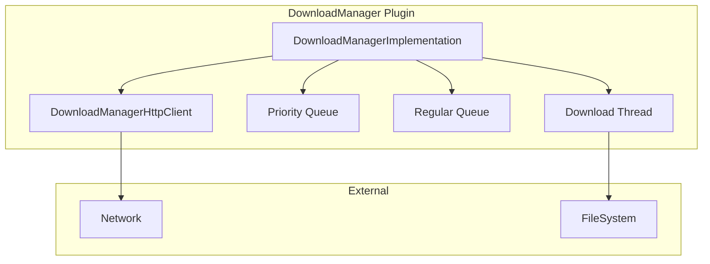
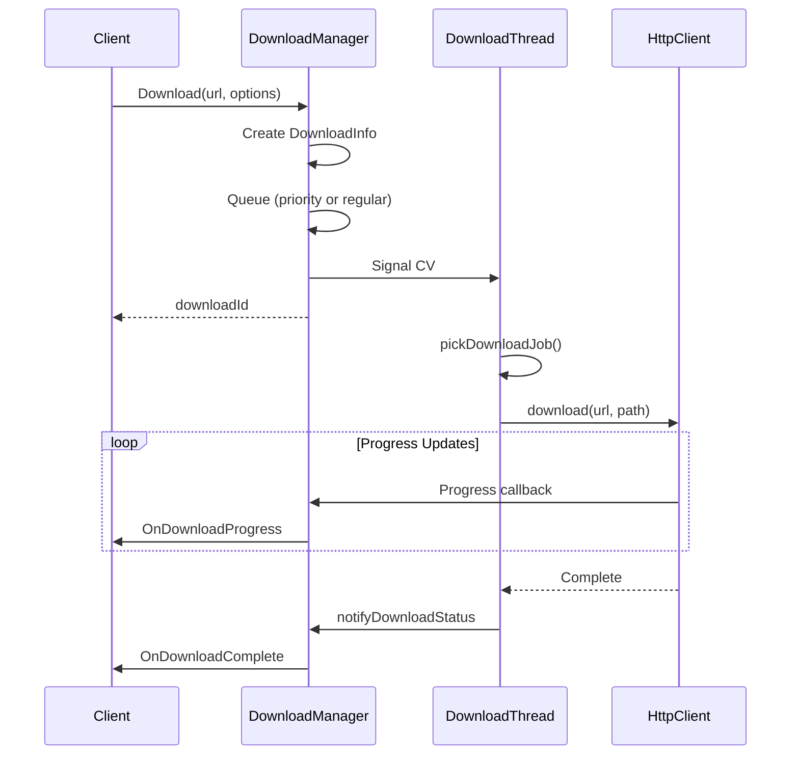
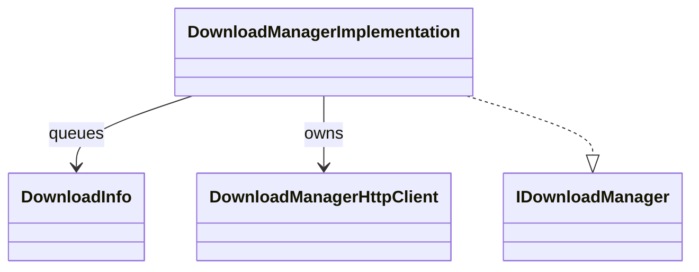
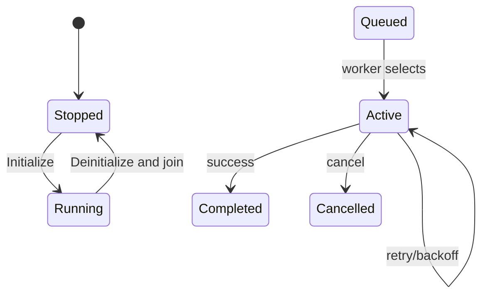

# DownloadManager Plugin Documentation

> HTTP Download Management with Priority Queuing for RDK Infrastructure

## 1. High-Level Purpose & Architecture

### Role in ENT / RDK Infrastructure

The **DownloadManager** plugin provides a dedicated HTTP download service with priority queuing, rate limiting, and retry mechanisms. It is designed as a standalone download service separate from PackageManager for general-purpose download needs.

### Responsibilities

- **HTTP Downloads**: Manage HTTP/HTTPS file downloads
- **Priority Queuing**: Support priority and regular download queues
- **Rate Limiting**: Enforce download rate limits per request
- **Retry Logic**: Automatic retries using the implementation's retry policy
- **Progress Reporting**: Report download progress to subscribers

### Interacting Subsystems

| Subsystem | Interaction Type | Purpose |
|-----------|-----------------|---------|
| PackageManager | COM-RPC (potential) | May delegate downloads |
| FileSystem | Direct | Store downloaded files |

---

## 2. Architectural Overview

### Major Components



---

## 3. Code Organization (Folder & File-Level)

### Directory Structure

```
DownloadManager/
├── DownloadManager.cpp              # Plugin shell
├── DownloadManager.h                # Shell header
├── DownloadManagerImplementation.cpp # Core implementation
├── DownloadManagerImplementation.h   # Implementation header
├── DownloadManagerHttpClient.cpp    # HTTP client
├── DownloadManagerHttpClient.h      # HTTP client header
├── DownloadManagerTelemetryReporting.cpp # Telemetry
├── DownloadManagerTelemetryReporting.h   # Telemetry header
├── Module.cpp                       # Plugin module
├── Module.h                         # Module header
├── CMakeLists.txt                   # Build configuration
├── DownloadManager.config           # Plugin configuration
└── DownloadManager.conf.in          # Configuration template
```

### Key Implementation Details

```cpp
// From DownloadManagerImplementation.h
class DownloadManagerImplementation : public Exchange::IDownloadManager {
    class DownloadInfo {
        string id;
        string url;
        bool priority;
        uint8_t retries;
        uint32_t rateLimit;
        string fileLocator;
        bool isCancelled;
    };

    typedef std::shared_ptr<DownloadInfo> DownloadInfoPtr;
    typedef std::queue<DownloadInfoPtr> DownloadQueue;

private:
    std::unique_ptr<DownloadManagerHttpClient> mHttpClient;
    DownloadQueue mPriorityDownloadQueue;
    DownloadQueue mRegularDownloadQueue;
    std::unique_ptr<std::thread> mDownloadThreadPtr;
    std::atomic<bool> mDownloaderRunFlag;
    DownloadInfoPtr mCurrentDownload;
    uint32_t mDownloadId;
    std::string mDownloadPath;
};
```

---

## 4. Class & Interface Documentation

### Exchange::IDownloadManager Interface

```cpp
interface IDownloadManager {
    enum FailReason {
        NONE = 0,
        DISK_PERSISTENCE_FAILURE,
        DOWNLOAD_FAILURE
    };

    // Options fields are documented in table format below.

    interface INotification {
        void OnDownloadComplete(const string& downloadId, const string& fileLocator,
                               FailReason reason);
        void OnDownloadProgress(const string& downloadId, uint8_t percent);
    };

    hresult Download(const string& url, const Options& options, string& downloadId);
    hresult Pause(const string& downloadId);
    hresult Resume(const string& downloadId);
    hresult Cancel(const string& downloadId);
    hresult Delete(const string& fileLocator);
    hresult Progress(const string& downloadId, uint8_t& percent);
    hresult RateLimit(const string& downloadId, uint32_t limit);
    hresult Register(INotification* notification);
    hresult Unregister(INotification* notification);
    hresult Initialize(PluginHost::IShell* service);
    hresult Deinitialize(PluginHost::IShell* service);
};
```

`IDownloadManager::Options` fields:

| Field | Type | Description |
|-------|------|-------------|
| `priority` | `bool` | Indicates whether the download goes to priority queue |
| `retries` | `uint8_t` | Number of retry attempts |
| `rateLimit` | `uint32_t` | Download speed limit |

---

## 5. Configuration & Build Integration

The implementation declares `downloadDir` and `downloadId`; plugin settings include `mode`, `locator`, `autostart`, and `startuporder`. The checked-in [DownloadManager.config](DownloadManager.config) omits `downloadDir` and `downloadId` even though [DownloadManager.conf.in](DownloadManager.conf.in) declares them. [CMakeLists.txt](CMakeLists.txt) requires libcurl.

### Plugin Configuration

```cmake
set (autostart false)
set (preconditions Platform)
set (callsign "org.rdk.DownloadManager")
```

### Runtime Configuration

```json
{
    "downloadDir": "/tmp/downloads",
    "downloadId": 1
}
```

## 6. Internal Workflows & Execution Flow

### Download Processing Flow



### Retry Behavior

The implementation exposes retry-related options and reports download failures through `IDownloadManager`. Its current `nextRetryDuration` helper uses a golden-ratio multiplier for retry delays:

```cpp
int nextRetryDuration(int n) {
    const double goldenRatio = (1 + std::sqrt(5)) / 2.0;
    double next = n * goldenRatio;
    return static_cast<int>(std::round(next));
}
```

The exact scheduling and retry limits remain implementation details.

### Package Download Telemetry

DownloadManager publishes two events directly through `ITelemetryMetrics::PublishEvent` after a download reaches a terminal state. Both use the generated download ID as `metricContext`; source URLs and CURL codes are never sent.

| Marker | Trigger | Enablement | Fields |
|--------|---------|------------|--------|
| `ENTS_INFO_RDKAMAppPackageDownloadComplete` | Download finished with no error | Only with `APP_MANAGER_OBSERVABILITY_VERBOSE` | `metricContext`, `packageSize` (bytes), `priority`, `rateLimit`, `totalRetries`, `timeInQueue` (ms), `totalDownloadTime` (ms) |
| `ENTS_INFO_RDKAMAppPackageDownloadError` | Download failed after retries (404 stops early) | Always | `metricContext`, `errorTelemetry` |

`timeInQueue` runs from `Download()` entry to the first transfer attempt. `totalDownloadTime` runs from `Download()` entry to completion, including retries. `totalRetries` counts retries actually made. `rateLimit` is reported as passed to CURL (bytes/s). An HTTP status of 400 or higher is treated as a failed attempt, so error pages are no longer reported as a successful download. Requests rejected before a download ID exists (no internet, empty URL) publish no marker.

`errorTelemetry` values: `DISK_WRITE_ERROR`, `URL_INVALID`, `NETWORK_DNS_FAILURE`, `NETWORK_TIMEOUT`, `NETWORK_CONNECTION_REFUSED`, `NETWORK_SSL_ERROR`, `NETWORK_AUTH_ERROR` (HTTP 401/403), `NETWORK_SERVER_ERROR` (5xx), `NETWORK_RATE_LIMITED` (429), `NETWORK_NOT_FOUND` (404), `NETWORK_CONTENT_ERROR` and the fallback `NETWORK_ERROR`.

The legacy `DownloadTime` and `DownloadError` markers are unchanged.

---

## 7. Diagrams & Visual Aids





## 8. Testing & Quality Analysis

### Existing Tests

Located in `Tests/L1Tests/tests/test_DownloadManager.cpp`

| Test | Description |
|------|-------------|
| Download | Basic download functionality |
| Priority | Priority queue handling |
| Cancel | Download cancellation |
| Progress | Progress reporting |

L0 coverage also covers lifecycle, implementation, HTTP client, telemetry, retry/queue, and shutdown behavior under [Tests/L0Tests/DownloadManager](../Tests/L0Tests/DownloadManager); L1 coverage exists. Add tests for worker-start failure, concurrent cancel/completion, retry exhaustion, and configuration parity.

## 9. Beginner-to-Expert Teaching Mode

**Must know first:** understand producer/consumer queues, the downloader worker, download id versus file locator, and notification delivery.

**Advanced path:** inspect queue locking, cancellation visibility, rate limiting, retry backoff, libcurl error mapping, and shutdown lifetime.
