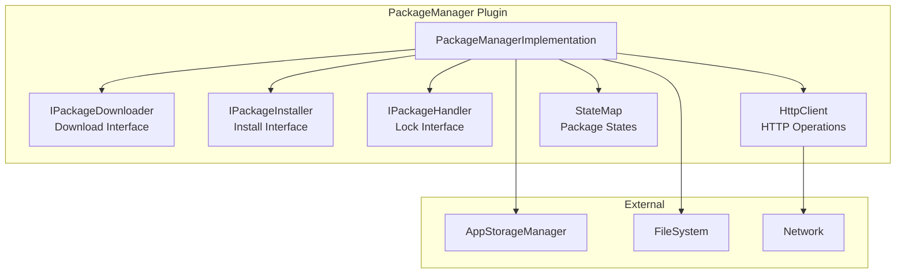
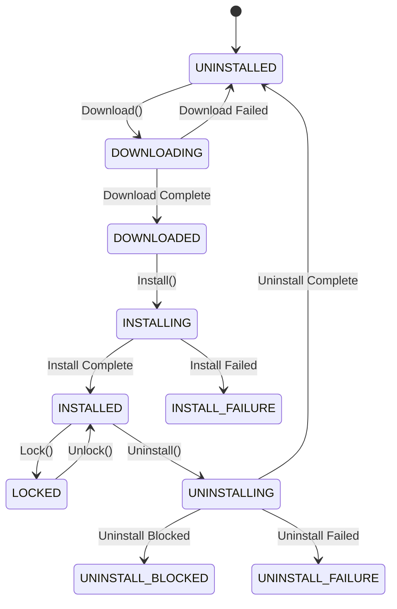
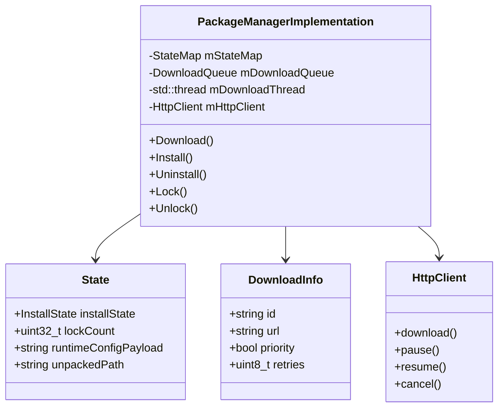
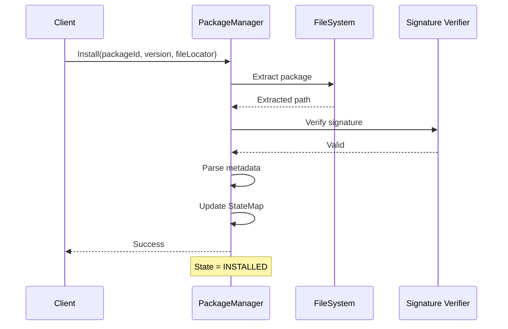
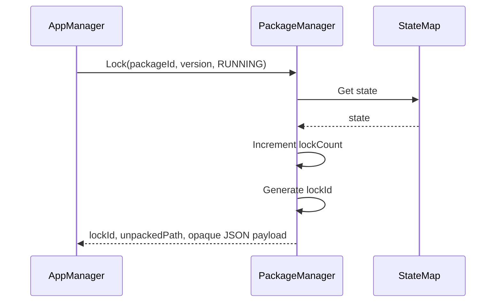
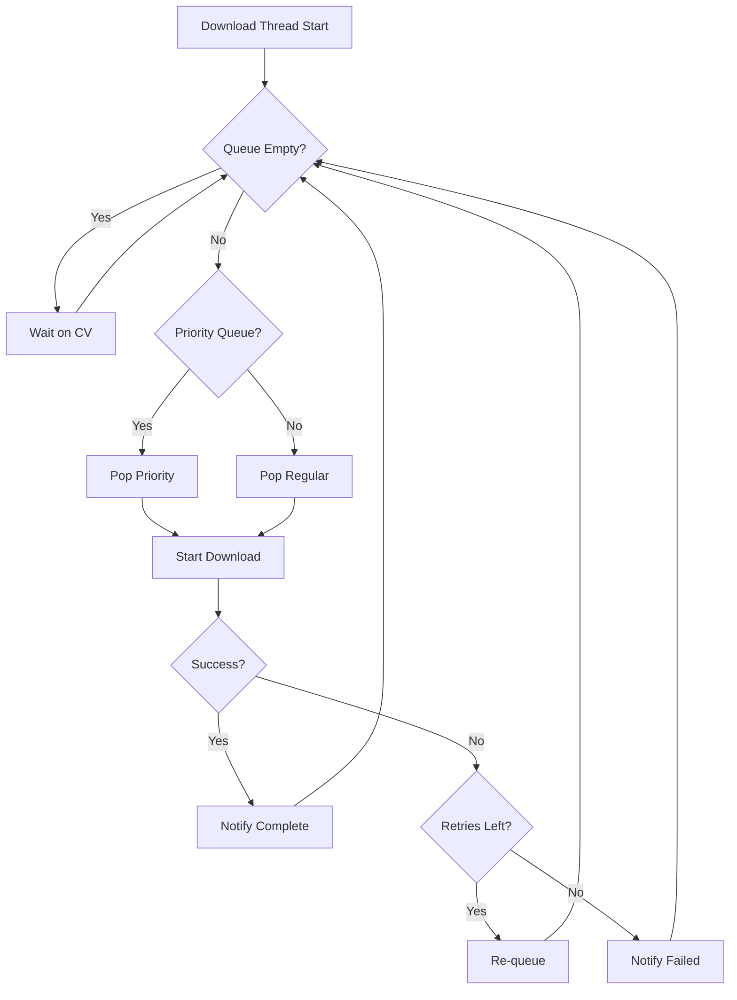
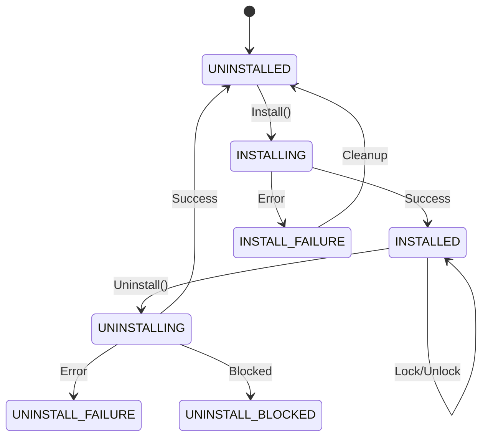
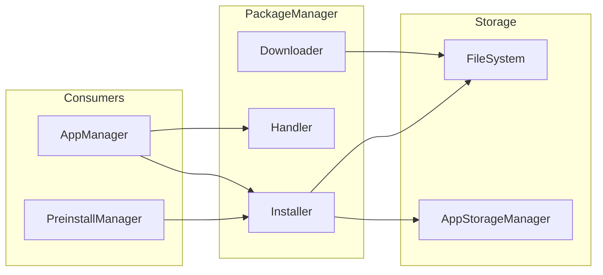

# PackageManager Plugin Documentation

> Package Download, Installation, and Management for RDK Infrastructure

## 1. High-Level Purpose & Architecture

### Role in ENT / RDK Infrastructure

The **PackageManager** plugin provides comprehensive package management capabilities including downloading, installing, locking, and uninstalling application packages. It serves as the central authority for package state and metadata.

### Responsibilities

- **Package Download**: Download packages via HTTP with retry and rate limiting
- **Package Installation**: Install packages with signature verification and metadata extraction
- **Package Locking**: Lock packages during app execution to prevent modification
- **Package State Management**: Track installation state for all packages
- **Runtime Configuration**: Create and return a flat, opaque JSON payload for the launch pipeline; array-valued metadata remains JSON arrays and unknown properties are preserved by later enrichers

### Interacting Subsystems

| Subsystem | Interaction Type | Purpose |
|-----------|-----------------|---------|
| AppManager | COM-RPC (inbound) | Lock/unlock packages, list installed apps |
| PreinstallManager | COM-RPC (inbound) | Install pre-loaded packages |
| AppStorageManager | COM-RPC (outbound) | Manage package storage |

### What It Does NOT Do

- Does not manage application lifecycle (handled by LifecycleManager)
- Does not run containers (handled by RuntimeManager)
- Does not manage application-specific data (handled by AppStorageManager)

---

## 2. Architectural Overview

### Major Components



### AppPackageInstallError Telemetry

PackageManager publishes `ENTS_INFO_RDKAMAppPackageInstallError` when an install or uninstall operation fails. The event is enabled by default and includes:

| Field | Type | Description |
|-------|------|-------------|
| `metricContext` | string | Opaque package identity in `packageId:version` format |
| `errorTelemetry` | string | Hierarchical error category |

| Category | Value | Description |
|----------|-------|-------------|
| Signature | `SIGNATURE_INVALID` | Package signature verification failed |
| Version | `VERSION_MISMATCH` | Package version mismatch |
| Version | `VERSION_NOT_FOUND` | Requested version is not available |
| Metadata | `METADATA_INVALID` | Package metadata is invalid or corrupted |
| Storage | `STORAGE_WRITE_ERROR` | Unable to persist package data to storage |
| Uninstall | `UNINSTALL_FAILED` | Generic uninstall failure with no specific reason |
| Uninstall | `UNINSTALL_SIGNATURE_INVALID` | Signature verification failed during uninstall |
| Uninstall | `UNINSTALL_VERSION_MISMATCH` | Package version mismatch during uninstall |
| Uninstall | `UNINSTALL_METADATA_INVALID` | Invalid metadata encountered during uninstall |
| Uninstall | `UNINSTALL_STORAGE_CLEANUP_FAILED` | Storage cleanup failed after package removal |
| Uninstall | `UNINSTALL_VERSION_NOT_FOUND` | Requested version was not found during uninstall |

Unclassified install failures are logged and skipped. The current package-manager result interface does not distinguish an install `VERSION_NOT_FOUND` or an uninstall `UNINSTALL_METADATA_INVALID` result; generic uninstall failures use `UNINSTALL_FAILED`.

### AppPackageDownloadError Telemetry

PackageManager publishes `ENTS_INFO_RDKAMAppPackageDownloadError` after a package download fails, once retries are exhausted. The event is enabled by default. Its `metricContext` is the generated download ID; source URLs and low-level CURL codes are not sent.

| Field | Type | Description |
|-------|------|-------------|
| `metricContext` | string | Opaque download ID identifying the package download |
| `errorTelemetry` | string | Normalized error category from the values below |

| Category | Error value | Description | Examples |
|----------|-------------|-------------|----------|
| Disk Errors | `DISK_WRITE_ERROR` | Unable to write to disk, including disk-full, permissions, or I/O errors | `CURLE_WRITE_ERROR`, output file open failure |
| URL Errors | `URL_INVALID` | Empty, malformed, or unsupported URL | Empty URL |
| Network Errors | `NETWORK_DNS_FAILURE` | DNS resolution failed | `CURLE_COULDNT_RESOLVE_HOST` |
| Network Errors | `NETWORK_TIMEOUT` | Connection or operation timed out | `CURLE_OPERATION_TIMEDOUT` |
| Network Errors | `NETWORK_CONNECTION_REFUSED` | Server refused the connection | `CURLE_COULDNT_CONNECT` |
| Network Errors | `NETWORK_SSL_ERROR` | SSL/TLS handshake or certificate error | `CURLE_SSL_CACERT_BAD`, `CURLE_SSL_CONNECT_ERROR` |
| Network Errors | `NETWORK_AUTH_ERROR` | Authentication failed | HTTP 401, 403 |
| Network Errors | `NETWORK_SERVER_ERROR` | Server returned a 5xx response | HTTP 500, 502, 503, 504 |
| Network Errors | `NETWORK_RATE_LIMITED` | Rate limit exceeded | HTTP 429 |
| Network Errors | `NETWORK_NOT_FOUND` | Resource not found on server | HTTP 404 |
| Network Errors | `NETWORK_CONTENT_ERROR` | Content length mismatch or corruption | `CURLE_PARTIAL_FILE`, content-length mismatch |
| Network Errors | `NETWORK_ERROR` | Generic fallback for uncategorized network failures | Other CURL errors |

### AppPackageDownloadComplete Telemetry

PackageManager publishes `ENTS_INFO_RDKAMAppPackageDownloadComplete` after a successful package download. The event is enabled only when `APP_MANAGER_OBSERVABILITY_VERBOSE` is enabled. Its `metricContext` is the generated download ID; source URLs are not sent. `timeInQueue` measures from request receipt to the first transfer attempt. `totalDownloadTime` measures from request receipt through successful completion, so network time (including retries) is `totalDownloadTime - timeInQueue`. `totalRetries` counts retry attempts actually made, excluding the initial attempt.

| Field | Type | Description |
|-------|------|-------------|
| `metricContext` | string | Opaque download ID identifying the package download |
| `packageSize` | integer | Downloaded package size in bytes |
| `priority` | boolean | `true` for an immediate/priority download |
| `rateLimit` | integer | Requested rate limit in kb/s; `0` means unbounded |
| `totalRetries` | integer | Number of retry attempts made |
| `timeInQueue` | integer | Milliseconds from request receipt to first transfer attempt |
| `totalDownloadTime` | integer | Milliseconds from request receipt to successful download completion |

On new devices, a burst of package installs may result in hundreds of downloads in a short period and briefly exceed the Telemetry T2 NFR of 10 events per device per minute.

### AppPackageInstallComplete Telemetry

PackageManager publishes `ENTS_INFO_RDKAMAppPackageInstallComplete` after a successful package install. It measures the install operation from the start of PackageManager's `Install` call through package installation and metadata/state updates; download time is not included. Firmware-preinstalled packages use the same event if they go through this install flow. The event is published only when `APP_MANAGER_OBSERVABILITY_VERBOSE` is enabled.

| Field | Type | Description |
|-------|------|-------------|
| `metricContext` | string | Opaque package identity in `packageId:version` format |
| `packageSize` | integer | Package file size in bytes |
| `appId` | string | Package ID verified against package metadata |
| `version` | string | Package version verified against package metadata |
| `installTime` | integer | Install duration in milliseconds |

### High-Level Package Workflow

The following diagram combines download and installation phases for orientation. `DOWNLOADING` and `DOWNLOADED` are download workflow labels, not values from the `IPackageInstaller::InstallState` enum documented below.



---

## 3. Code Organization (Folder & File-Level)

### Directory Structure

```
PackageManager/
├── PackageManager.cpp              # Plugin shell (if separate)
├── PackageManager.h                # Shell header
├── PackageManagerImplementation.cpp # Core implementation
├── PackageManagerImplementation.h   # Implementation header
├── HttpClient.cpp                  # HTTP download client
├── HttpClient.h                    # HttpClient header
├── PackageManagerTelemetryReporting.cpp # Telemetry
├── PackageManagerTelemetryReporting.h   # Telemetry header
├── Module.cpp                      # Plugin module
├── Module.h                        # Module header
├── cmake/                          # CMake modules
├── CMakeLists.txt                  # Build configuration
├── PackageManager.conf.in          # Configuration template
└── PackageManager.md               # Original documentation
```

### File-by-File Breakdown

#### PackageManagerImplementation.h / PackageManagerImplementation.cpp

**Purpose**: Core package management implementing three interfaces.

**Key Interfaces**:
- `Exchange::IPackageDownloader` - Download management
- `Exchange::IPackageInstaller` - Installation management
- `Exchange::IPackageHandler` - Lock/unlock management

**Key Types**:
`State` fields:

| Field | Type | Description |
|-------|------|-------------|
| `installState` | `InstallState` | Current package installation state |
| `mLockCount` | `uint32_t` | Number of active locks |
| `runtimeConfigPayload` | `string` | Flat opaque JSON payload created from package runtime metadata |
| `gatewayMetadataPath` | `string` | Path to gateway metadata |
| `unpackedPath` | `string` | Path to unpacked package contents |
| `failReason` | `FailReason` | Last failure reason |
| `additionalLocks` | `std::list<AdditionalLock>` | Additional lock records |
| `runtimeType` | `string` | Runtime type associated with package |
| `runtimeApp` | `std::pair<std::string, std::string>` | Runtime app tuple information |

`DownloadInfo` fields:

| Field | Type | Description |
|-------|------|-------------|
| `id` | `string` | Download identifier |
| `url` | `string` | Source URL |
| `priority` | `bool` | Priority queue flag |
| `retries` | `uint8_t` | Retry attempt limit |
| `rateLimit` | `long` | Download rate limit |
| `fileLocator` | `string` | Destination file locator/path |
| `cancel` | `bool` | Cancellation flag |

**Key Methods**:
```cpp
// IPackageDownloader
Core::hresult Download(const string& url, const Options& options, DownloadId& downloadId);
Core::hresult Pause(const string& downloadId);
Core::hresult Resume(const string& downloadId);
Core::hresult Cancel(const string& downloadId);
Core::hresult Delete(const string& fileLocator);
Core::hresult Progress(const string& downloadId, ProgressInfo& progress);

// IPackageInstaller
Core::hresult Install(const string& packageId, const string& version,
                      IKeyValueIterator* additionalMetadata,
                      const string& fileLocator, FailReason& failReason);
Core::hresult Uninstall(const string& packageId, string& errorReason);
Core::hresult ListPackages(IPackageIterator*& packages);
Core::hresult Config(const string& packageId, const string& version,
                     string& runtimeConfigPayload);
Core::hresult PackageState(const string& packageId, const string& version,
                           InstallState& state);

// IPackageHandler
Core::hresult Lock(const string& packageId, const string& version,
                   LockReason lockReason, uint32_t& lockId,
                   string& unpackedPath, string& runtimeConfigPayload,
                   ILockIterator*& appMetadata);
Core::hresult Unlock(const string& packageId, const string& version);
Core::hresult GetLockedInfo(const string& packageId, const string& version,
                            string& unpackedPath, string& runtimeConfigPayload,
                            string& gatewayMetadataPath, bool& locked);
```

#### HttpClient.h / HttpClient.cpp

**Purpose**: HTTP client for package downloads with progress reporting.

**Key Features**:
- Resumable downloads
- Progress callbacks
- Rate limiting support
- Retry logic

---

## 4. Class & Interface Documentation

### Exchange::IPackageDownloader Interface

```cpp
interface IPackageDownloader {
    enum Reason {
        NONE = 0,
        DISK_PERSISTENCE_FAILURE,
        DOWNLOAD_FAILURE,
        CANCELLED
    };

    // Options fields are documented in table format below.

    interface INotification {
        void OnDownloadComplete(const string& downloadId, const string& fileLocator,
                               Reason reason);
        void OnDownloadProgress(const string& downloadId, uint32_t percent);
    };

    hresult Download(const string& url, const Options& options, string& downloadId);
    hresult Pause(const string& downloadId);
    hresult Resume(const string& downloadId);
    hresult Cancel(const string& downloadId);
    hresult Delete(const string& fileLocator);
    hresult Progress(const string& downloadId, ProgressInfo& progress);
    hresult Register(INotification* notification);
    hresult Unregister(INotification* notification);
};
```

### Exchange::IPackageInstaller Interface

```cpp
interface IPackageInstaller {
    enum InstallState {
        UNINSTALLED = 0,
        INSTALLING,
        INSTALLATION_BLOCKED,
        INSTALL_FAILURE,
        INSTALLED,
        UNINSTALLING,
        UNINSTALL_FAILURE,
        UNINSTALL_BLOCKED
    };

    enum FailReason {
        NONE = 0,
        SIGNATURE_VERIFICATION_FAILED,
        PACKAGE_MISMATCH,
        INVALID_METADATA,
        PERSISTENCE_FAILURE,
        VERSION_NOT_FOUND
    };

    // Package fields are documented in table format below.

    interface INotification {
        void OnAppInstallationStatus(const string& jsonResponse);
    };

    hresult Install(const string& packageId, const string& version,
                    IKeyValueIterator* metadata, const string& fileLocator,
                    FailReason& failReason);
    hresult Uninstall(const string& packageId, string& errorReason);
    hresult ListPackages(IPackageIterator*& packages);
    hresult Config(const string& packageId, const string& version,
                   string& runtimeConfigPayload);
    hresult PackageState(const string& packageId, const string& version,
                         InstallState& state);
    hresult Register(INotification* notification);
    hresult Unregister(INotification* notification);
};
```

`IPackageDownloader::Options` fields:

| Field | Type | Description |
|-------|------|-------------|
| `priority` | `bool` | Indicates whether to enqueue as priority download |
| `retries` | `uint8_t` | Number of retry attempts |
| `rateLimit` | `uint64_t` | Maximum download rate |

`IPackageInstaller::Package` fields:

| Field | Type | Description |
|-------|------|-------------|
| `id` | `string` | Package identifier |
| `version` | `string` | Package version |
| `state` | `InstallState` | Current install state |

### Exchange::IPackageHandler Interface

```cpp
interface IPackageHandler {
    enum LockReason {
        RUNNING = 0,
        PRELOADED,
        SYSTEM
    };

    hresult Lock(const string& packageId, const string& version,
                 LockReason reason, uint32_t& lockId,
                 string& unpackedPath, string& runtimeConfigPayload,
                 ILockIterator*& metadata);
    hresult Unlock(const string& packageId, const string& version);
    hresult GetLockedInfo(const string& packageId, const string& version,
                          string& unpackedPath, string& runtimeConfigPayload,
                          string& gatewayMetadataPath, bool& locked);
};
```

### Class Relationships



---

## 5. Configuration & Build Integration

### CMake Build Options

| Option | Description | Default |
|--------|-------------|---------|
| `PLUGIN_PACKAGE_MANAGER_MODE` | Execution mode | Off |
| `PLUGIN_PACKAGE_MANAGER_AUTOSTART` | Auto-start | false |

### Configuration Parameters

The implementation defines `downloadDir` as its package-download configuration key. No checked-in `PackageManager.config` exists in this workspace, and the source does not define `maxConcurrentDownloads`, `defaultRetries`, or `defaultRateLimit` as PackageManager configuration parameters.

---

## 6. Internal Workflows & Execution Flow

### Package Installation Flow



### Package Lock Flow



### Download Queue Processing



---

## 7. Diagrams & Visual Aids

### Package State Diagram



### Component Integration



---

## 8. Testing & Quality Analysis

### Existing Tests

Located in `Tests/L1Tests/tests/test_PackageManager.cpp`:

| Test Category | Description |
|---------------|-------------|
| Download Tests | HTTP download with various options |
| Install Tests | Package installation and verification |
| Uninstall Tests | Package removal |
| Lock/Unlock Tests | Package locking mechanism |
| State Tests | State transitions |

### Test Coverage Gaps

1. **Concurrent Downloads**: Multiple simultaneous downloads
2. **Rate Limiting**: Download rate limit enforcement
3. **Signature Verification**: Various signature scenarios
4. **Lock Contention**: Multiple lock requests

---

## 9. Beginner-to-Expert Teaching Mode

**Must know first:** package state includes versions, locks, runtime metadata, and storage paths, not only installed/uninstalled status.

**Advanced path:** trace download-to-install state transitions, inspect lock accounting and blocked operations, then compare RALF and non-RALF builds and cache initialization modes.
