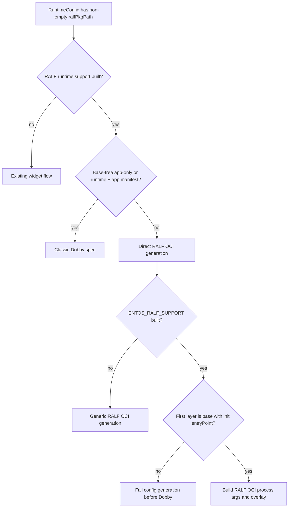

# RALF Application Launch Scenarios HLA

## Purpose

This note explains how RuntimeManager chooses a launch path for a RALF
application based on its dependency-first lock manifest. It focuses on the
important distinction between a RALF package layer and an installed ZIP/Sky
widget used as a W3C runtime dependency.

The package-side manifest and mount paths are described in the
[RALF package support HLA](RALF_Package_Support_HLA.md).

## Decision Summary

The manifest order is dependencies first and application last. RuntimeManager
uses the same order to read each layer's config. The package-layer paths become
overlay lowerdirs for direct OCI launches; a recognized base-free launch
supplies the runtime, when present, and application paths to the established
Dobby spec generator.

## Scenarios

| Package/dependency shape | EntOS launch result | Key behavior |
|---|---|---|
| RALF application with no dependency | Classic Dobby spec | The one-layer application config must include a safe relative `entryPoint`. |
| RALF runtime + RALF application, no base | Classic Dobby spec | The runtime layer must be typed `runtime`; if it has no executable, the app entry point is used and `/runtime` is not mounted. App config must be typed `application` with an entry point. |
| RALF base + RALF application | Direct RALF OCI launch | The first layer must have `packageType: "base"` and a non-empty `entryPoint`; the app must also have a non-empty `entryPoint`. The base init runs first, followed by any intermediate layer entrypoints, then the app entrypoint and app `entryArgs`. |
| RALF base + RALF runtime/resource dependencies + RALF application | Direct RALF OCI launch | RALF dependencies are recursively mounted and represented by their own signed layer configs. Valid intermediate `entryPoint` values are included in process order. Non-entrypoint metadata still contributes its layer/config, but no process argument. |
| One ZIP/Sky widget runtime dependency + RALF application, exactly two layers | Classic Dobby spec, if the ZIP runtime role matches | The ZIP dependency contributes its pinned PackageDatabase extracted-cache path and a synthetic config containing its `runtime/` role and executable. It is not mounted through libralf. |
| ZIP/Sky widget dependency with extra layers, missing entrypoint, or non-runtime role | Not recognized as the classic runtime case | RuntimeManager falls through to direct RALF OCI generation. Base-backed sets are handled there; unsupported base-free shapes fail generation before Dobby. |
| Direct EntOS RALF OCI launch without a base layer or base init entrypoint | Fails before Dobby starts | `setLegacyProcessArgs()` rejects OCI manifests requiring base init; eligible base-free app/runtime sets are diverted to classic Dobby first. |
| RALF package support not compiled into RuntimeManager | Existing widget-generation path | `isRalfPackage()` always returns false in this build, even if a path is present in runtime configuration. |

## RALF Base and RALF Runtime Layers

For direct RALF OCI generation with `ENTOS_RALF_SUPPORT`,
`RalfOCIConfigGenerator::setLegacyProcessArgs()` validates the layer sequence:

1. At least two package configs must be present.
2. The first config must be `packageType: "base"` and provide a non-empty
   `entryPoint` (the base init executable).
3. The final config must provide a non-empty application `entryPoint`.
4. The resulting `process.args` is base entrypoint, each non-empty intermediate
   entrypoint in manifest order, app entrypoint, and app `entryArgs`.

Intermediate `entryArgs` are not appended by this legacy process-argument
builder. `RalfOCIConfigGenerator` still applies each layer's config, permissions,
and environment contributions independently of argument construction.

The base-layer check is EntOS-specific. With `ENTOS_RALF_SUPPORT` disabled,
RuntimeManager does not call `setLegacyProcessArgs()` and uses the existing
per-layer OCI config behavior plus the preinstalled graphics layer. The
base-free classic-launch selection is independent of the EntOS OCI argument
policy.

The package handler locks dependencies before the app. In a direct launch,
RuntimeManager reverse-iterates the manifest paths for overlayfs lowerdir
precedence, while process args are constructed from the original dependency-first
config order. Package mount roots use `.packages.mountsTmpDir`; extraction
fallback roots use
`.packages.extractionTmpDir/ralf/<appId>_<version>/rootfs`. The per-instance overlay uses the
RuntimeManager bundle root (`/run/sky/bundles/<instance>` with EntOS support,
otherwise `/tmp/ralf/<instance>`).

## Non-RALF Sky Widget Runtime Dependency

`libpackage-sky` can satisfy a RALF dependency using an installed ZIP widget.
It resolves the widget version from PackageDatabase, verifies the on-disk file
is not RALF, loads and pins the widget's extracted cache, and adds that extracted
directory as a manifest layer. It does not send ZIP bytes through libralf. The
widget layer's companion config carries its `runtime/` or `base/` role and
executable; other widget metadata remains outside the shared RALF config.

RuntimeManager recognizes a two-layer classic widget runtime when the
first layer config is typed `runtime`, the app entry point is present, and
the selected executable is safe and relative. A runtime with an executable
supplies its ZIP extraction as `runtimePath`; otherwise the app entry point
is used and the runtime bind is omitted. It supplies the RALF app root as
`appPath` and calls the ordinary `DobbySpecGenerator` rather than
`RalfPackageBuilder`/`RalfOCIConfigGenerator`. If
`<launchConfig.unpackedPath>/data.img` exists as a regular file, it is used as
the private ext4 image for `/home/private`; otherwise that optional loop mount
is omitted. The RALF package directory itself is never treated as the image.

A one-layer application manifest can also use classic Dobby when its entrypoint
is safe and relative. Other layer shapes proceed through direct RALF OCI
generation, where EntOS base-layer validation applies.

## Build and Runtime Boundaries

- `RALF_PACKAGE_SUPPORT` controls whether RuntimeManager compiles the RALF
  dispatch and direct OCI builder. The runtime discriminator is a non-empty
  `ralfPkgPath`; an empty path preserves the ordinary widget launch.
- `ENTOS_RALF_SUPPORT` adds the base/runtime/app argument policy, generated
  vendor GPU layer, and `/run/sky/bundles` root. If disabled, direct RALF support still uses `/tmp/ralf` and the
  preinstalled graphics rootfs.
- A missing dependency/version or a failed package lock prevents a valid
  manifest from being handed to RuntimeManager. A process-argument or OCI
  generation failure happens later and is cleaned up before `StartContainer`.

The surrounding filesystem paths, mount-target setup, and cross-repository
handoff are in the [RALF package support HLA](RALF_Package_Support_HLA.md).