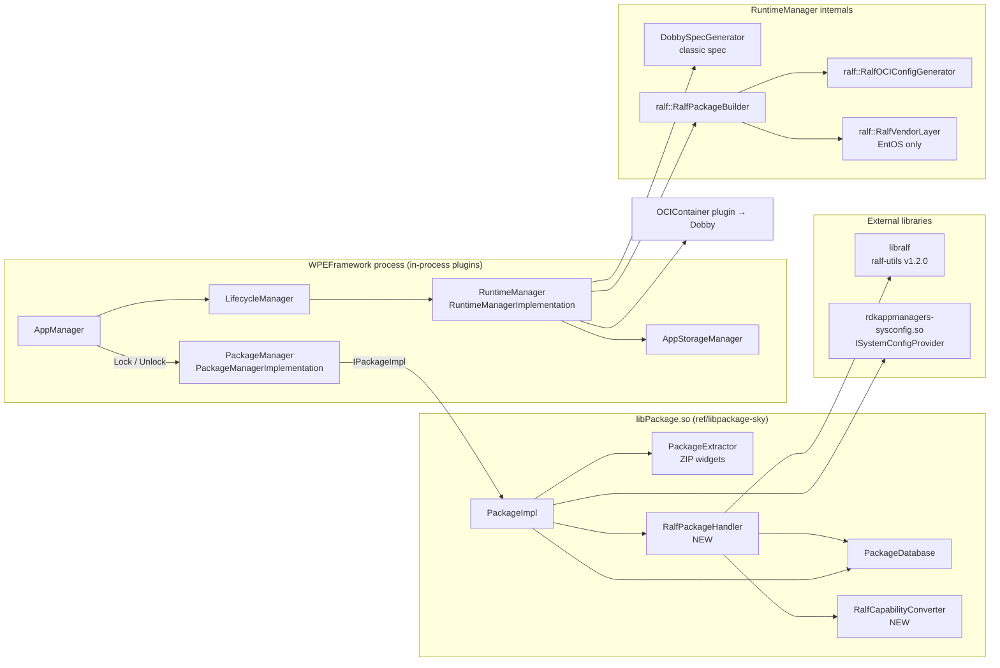

# 01 – RALF Overview and Architecture

## 1. What is RALF?

**RALF** (RDK Application Layer Format, referred to in some tickets as a "Bolt package") is the
package format implemented by [`ralf-utils`](https://github.com/rdkcentral/ralf-utils) (library
name **libralf**). Compared with the legacy EntOS **ZIP widget** (`.wgt` with `config.xml` +
`signature1.xml`):

| Aspect | EntOS ZIP widget | RALF package |
|--------|------------------|--------------|
| Container format | ZIP archive with `config.xml` + `signature1.xml` | Archive holding an OCI image layout (`oci-layout`, `index.json`, `blobs/sha256/...`) – on the device it is itself ZIP-readable, which is why the ZIP extractor could open it before the fix |
| Payload | Individual files, **extracted** to tmpfs | **EROFS** filesystem image, **mounted** read-only |
| Integrity | XML-DSig over every file, checked at extraction | Signed manifest + dm-verity root hash, checked per block at read time |
| Metadata | `config.xml` (+ capabilities string) | `ralf::PackageMetaData` (id, version, mimeType, entryPoint, dependencies, applicationInfo/serviceInfo, permissions, vendorConfig) + auxiliary metadata files (e.g. `application/vnd.rdk.package.config.v1+json`) |
| Dependencies | Implicit: `runtime` field → `findRuntime()` | Explicit: `dependencies()` with `VersionConstraint` |
| Layering | App + optional runtime, bind-mounted at `/package`, `/runtime` | Base + runtime(s) + app, composed by **overlayfs** into one rootfs (or classic bind mounts when no base) |
| User | Per-app uid from `UserIdManager` | Per-app uid from `UserIdManager` (same as ZIP widgets and AI1; child apps use the parent's uid) |

Package type is detected **from content**, never from the file name:

```cpp
ralf::Package::detectPackageFormat(path) == ralf::Package::Format::Ralf
```

So a RALF archive can sit at `<packagesDir>/<appId>/package.wgt` exactly like a ZIP widget.

## 2. Components and repositories



| Repo | Role in RALF support |
|------|----------------------|
| `ref/libpackage-sky` | **Main implementation**: detection, verification, install, registration, dependency resolution, libralf mount, mount manifest, ZIP⇄RALF mixing. See [02](02_libpackage-sky_RALF_Changes.md). |
| `entservices-appmanagers/PackageManager` | Transports `ralfPkgPath`, `runtimePath`, `command`, env vars in the runtime-config payload. Essentially unchanged. |
| `entservices-appmanagers/RuntimeManager` | Chooses launch mode, builds classic Dobby spec or OCI bundle, owns overlayfs lifetime. See [03](03_entservices-appmanagers_RALF_Changes.md). |
| `entservices-appmanagers/AppStorageManager` | Gives the `ralf` group access to the storage base path. |
| `ref/entos-appmanagers` (`rdkappmanagers-sysconfig`) | `ISystemConfigProvider` implementation; supplies Dobby spec for widgets and (optionally) `getRalfContainerEnvVars()` for RALF. |
| `ref/ralf-utils` | libralf: `Package::open/verify/mount/extractTo/metaData/auxMetaDataFile`, `VersionConstraint`. |

## 3. The data contract

Everything RuntimeManager needs is carried in the runtime-config JSON payload produced by
`PackageManagerImplementation::getRuntimeConfig()` from `packagemanager::ConfigMetaData`.

| `ConfigMetaData` field | Payload key | Set by (RALF) | Consumed by |
|------------------------|-------------|---------------|-------------|
| `ralfPkgPath` | `ralfPkgPath` | `RalfPackageHandler::lock()` – path to mount manifest | `RuntimeManagerImplementation::isRalfPackage()` – **the sole RALF discriminator** |
| `appPath` | `appPath` | RALF: package file path; classic RALF: rewritten to app mount | `DobbySpecGenerator` (`/package` bind) |
| `runtimePath` | `runtimePath` | ZIP app + RALF runtime: runtime EROFS mount; classic RALF: runtime mount | `DobbySpecGenerator` (`/runtime` bind) |
| `command` | `command` | ZIP app + RALF runtime: runtime entryPoint (relative) | `DobbySpecGenerator` (`/runtime/<command>`) |
| `envVars` | `envVariables` | sysconfig `getRalfContainerEnvVars(RalfContainerEnvContext)` (platform + secret + watchdog + DIAL + launch method) first, then RALF dependency env, then package env | `RalfOCIConfigGenerator::addRuntimeEnvironmentToOCIConfig` |
| `userId/groupId` | `userId/groupId` | app's own uid (`PackageDatabase` → `UserIdManager`), apps/daemons gid | RuntimeManager / AppStorageManager |
| `capabilities` | `capabilities` | `RalfCapabilityConverter` output | DobbySpecGenerator (classic path), AppManager |
| `packageFormat` | – | `"ralf"` | libpackage internal |

### 3.1 The mount manifest (`ralfPkgPath`)

Written by `RalfPackageHandler::serializeMountInfo()` to
`$TMPDIR/<appId>_<version>_metadata.json`:

```json
{
  "packages": [
    { "pkgMountPath": "/var/run/sky/mounts/com.sky.base_1.0.0/rootfs",
      "pkgMetaDataPath": "/var/run/sky/mounts/com.sky.base_1.0.0/config.json" },
    { "pkgMountPath": "/var/run/sky/mounts/com.sky.cobalt_25.1.0/rootfs",
      "pkgMetaDataPath": "/var/run/sky/mounts/com.sky.cobalt_25.1.0/config.json" },
    { "pkgMountPath": "/var/run/sky/mounts/com.example.app_1.2.3/rootfs",
      "pkgMetaDataPath": "/var/run/sky/mounts/com.example.app_1.2.3/config.json" }
  ]
}
```

**Ordering rule (critical):** entries are written **post-order** – dependencies first, the
requested package last. `RalfPackageBuilder::generateOCIRootfsPackage()` reverse-iterates this
list to build the overlayfs `lowerdir` chain, so the app ends up with the highest precedence.
`getClassicRalfLaunchInfo()` also relies on it (`packages.back()` = app, `packages.front()` = runtime).

### 3.2 The per-layer `config.json`

`RalfPackageHandler::emitPackageConfig()` writes one file per mounted layer, **outside** the
read-only mount (`<workDir>/config.json`, next to `<workDir>/rootfs`). Content = the package's
`application/vnd.rdk.package.config.v1+json` auxiliary metadata plus two normalised keys:

| Key | Value |
|-----|-------|
| `packageType` | `base` (`PackageType::Base`), `service` (has `serviceInfo`), `runtime` (mimeType starts `runtime/`), else `application` |
| `entryPoint` | from aux config, else `metaData->entryPointPath()` |
| `entryArgs` | libralf ≥ 1.0.5: `metaData->entryArgs()` |

ZIP widget dependencies get a **synthetic** `config.json` (`lockWidget()`), with `packageType`
derived from the widget's `runtime` (`runtime/…` → `runtime`, `base/…` → `base`) and
`entryPoint = execFilePath()`.

## 4. Where state lives on the device

| Path | Owner | Content |
|------|-------|---------|
| `<persistentStoreDir>/<appId>/package.wgt` | PackageDatabase / RalfPackageHandler | Installed package (ZIP **or** RALF) – one slot per appId |
| `.packages.mountsTmpDir` (default `/var/run/sky/mounts`) `/<id>_<ver>/rootfs` | RalfPackageHandler | libralf EROFS mount |
| `…/<id>_<ver>/config.json` | RalfPackageHandler | Normalised layer config |
| `…/<id>_<ver>_widget/config.json` | RalfPackageHandler | Synthetic config for a ZIP dependency of a RALF package |
| `<extractedTmpDir>/ralf/<id>_<ver>/rootfs` | RalfPackageHandler | Verified-extraction fallback when mount fails |
| `$TMPDIR/<id>_<ver>_metadata.json` | RalfPackageHandler | Mount manifest (`ralfPkgPath`) |
| `/run/sky/bundles/<appInstanceId>/` (EntOS) or `/tmp/ralf/<appInstanceId>/` | RuntimeManager | OCI bundle: `rootfs` (overlay), `upper`, `work`, `vendor`, `config.json` |

## 5. Build switches at a glance

| Switch | Where | Default | Effect |
|--------|-------|---------|--------|
| `ENABLE_RALF_PACKAGE_SUPPORT` | libpackage-sky CMake | **OFF** | Compiles `RalfPackageHandler.cpp` + `RalfCapabilityConverter.cpp`, links `ralf`; otherwise an inline stub is used |
| `RALF_PACKAGE_SUPPORT` → `RALF_PACKAGE_SUPPORT_ENABLED` | RuntimeManager / AppStorageManager CMake | **ON** (recipe: `enable_ralf` distro feature) | Compiles `RuntimeManager/ralf/*.cpp`; enables RALF dispatch |
| `ENTOS_RALF_SUPPORT` | RuntimeManager CMake | **ON** | EntOS vendor GPU layer, EntOS paths, legacy process args, glob dev nodes |
| `USE_LIBPACKAGE_RALF` | PackageManager CMake | **OFF** | Generic-libpackage companion runtime locking. Keep OFF with libpackage-sky |
| `ralfEnabled` | RuntimeManager plugin config | `true` | Runtime kill-switch: rejects RALF launches with `ERROR_RALF_DISABLED` |

Full analysis in [06](06_EntOS_Ifdefs_and_NonEntOS_Protection.md).
