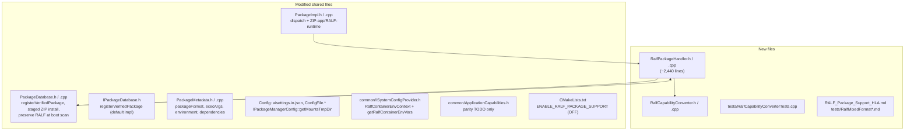
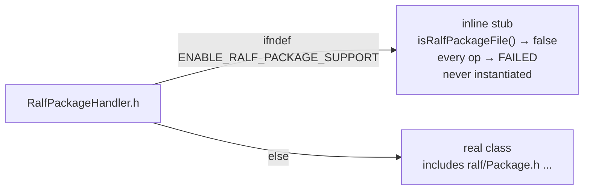
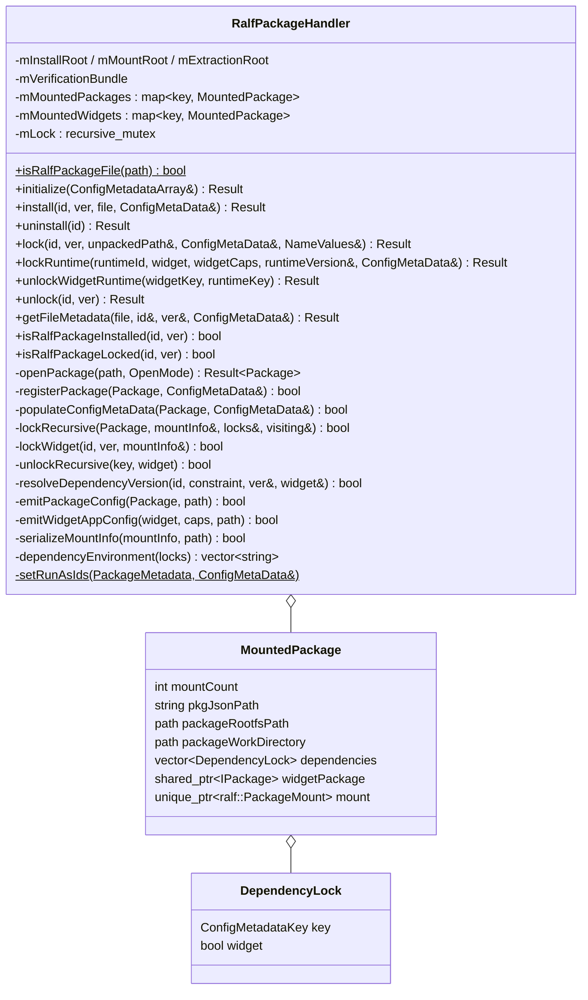
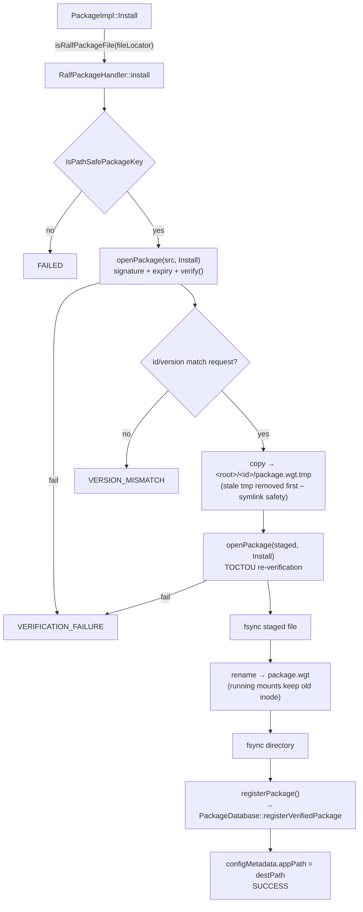
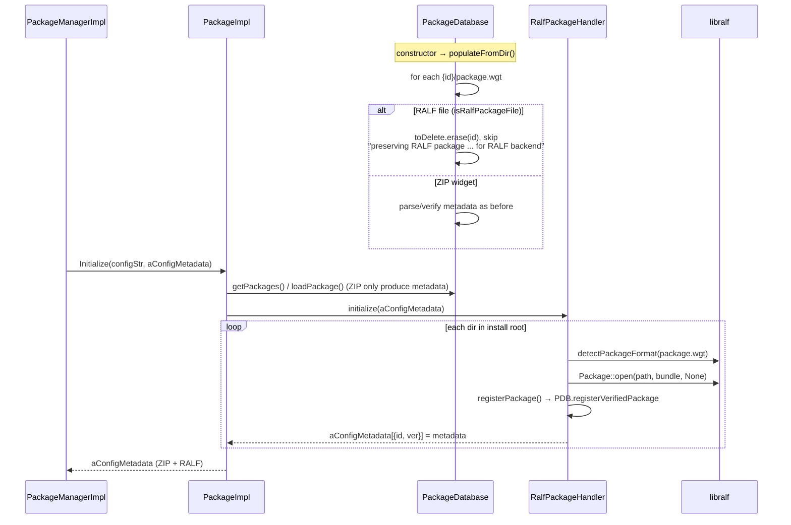
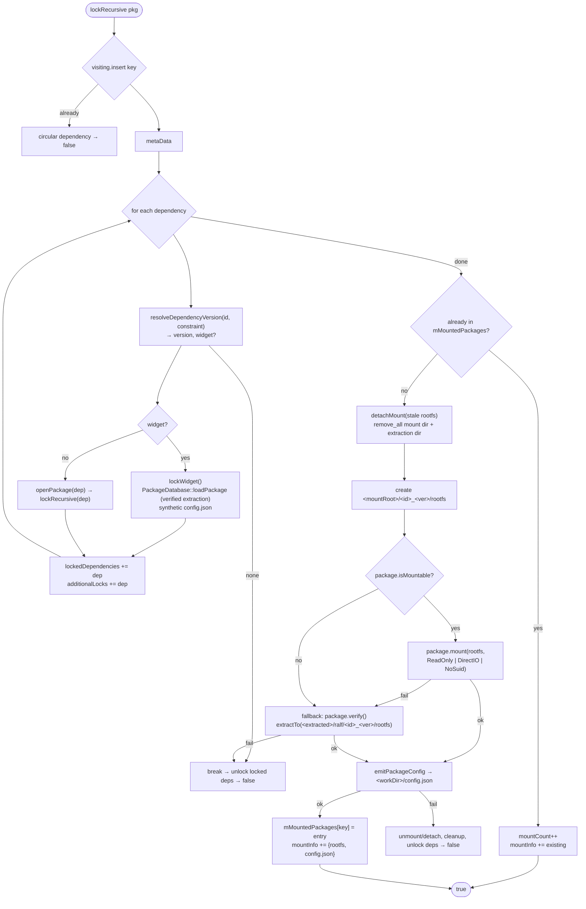
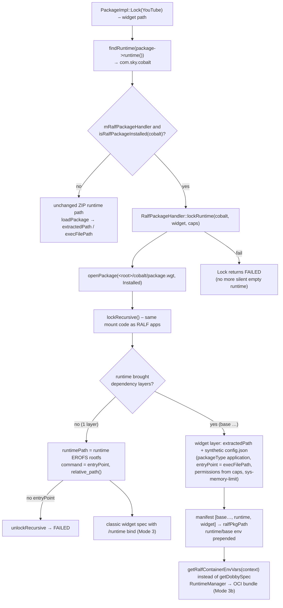
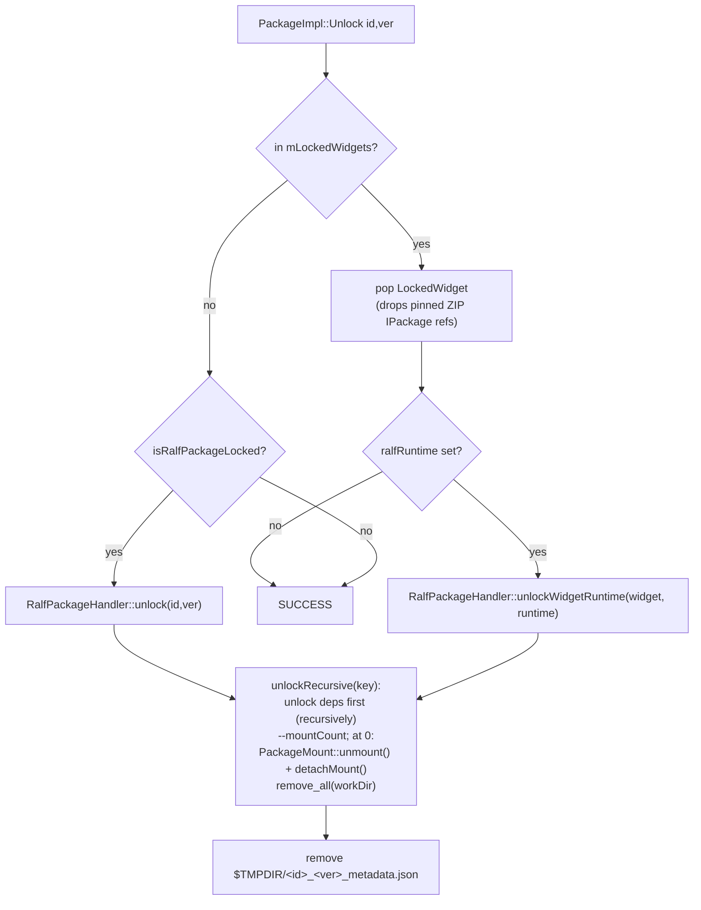

# 02 – libpackage-sky: RALF Changes in Detail

> **Repo:** `ref/libpackage-sky` · **Branch:** `topic/entos-ralf-support` (HEAD `01d0ec6`)
> **Baseline:** `develop` @ `55652dc` (tag `1.2.0.0`) · **Size:** 23 files, +3167 / −56

libpackage-sky is where RALF support is actually *implemented*. Everything above it
(PackageManager, RuntimeManager) only transports or consumes the result. The design goal was
**additive**: the ZIP widget path (PackageExtractor, PackageDatabase, secrets, DIAL, DataImage,
UserId, `spec=` Dobby capability) keeps working byte-for-byte; RALF is a **parallel path** that
`PackageImpl` dispatches to.

---

## 1. Change map



| File | Δ | Purpose |
|------|---|---------|
| `RalfPackageHandler.h/.cpp` | **new** | All RALF logic: detect, verify, install, register, initialize, lock (recursive, mixed ZIP/RALF), **lockRuntime** (ZIP app + RALF runtime), unlock, mount manifest, layer config |
| `RalfCapabilityConverter.h/.cpp` | **new** | RALF permission URNs + lifecycle + keys → legacy comma-separated capability string |
| `PackageImpl.h/.cpp` | +138 | Constructs the handler; dispatches Install/Uninstall/Lock/Unlock/GetFileMetadata; locks RALF runtimes for ZIP apps; tracks them in `mLockedWidgets` |
| `PackageDatabase.cpp/.h` | +154 | `registerVerifiedPackage()`; ZIP install now stage→verify→fsync→rename; boot scan preserves RALF files |
| `IPackageDatabase.h` | +12 | `registerVerifiedPackage()` virtual with a safe default; removed unused `getPackageVersion()` |
| `PackageMetadata.h/.cpp` | +18 | `packageFormat`, `execArgs`, `environment`, `dependencies` |
| `Config/*`, `IPackageManagerConfig.h` | +12 | `.packages.mountsTmpDir` (default `/var/run/sky/mounts`) |
| `common/ISystemConfigProvider.h` | +40 | `RalfContainerEnvContext {appId, capabilities, appSecret, watchdogTimeout}`; `getRalfContainerEnvVars(appId, caps)` default `{}` and `getRalfContainerEnvVars(context)` default delegating to it |
| `CMakeLists.txt` | +14 | `ENABLE_RALF_PACKAGE_SUPPORT` option, `find_package(libralf)`, sources, link `ralf` |

---

## 2. Build integration and the stub

```cmake
option(ENABLE_RALF_PACKAGE_SUPPORT "Enable RALF/Bolt package support via ralf-utils" OFF)
if(ENABLE_RALF_PACKAGE_SUPPORT)
    find_package(libralf REQUIRED)
    add_definitions(-DENABLE_RALF_PACKAGE_SUPPORT)
endif()
...
if(ENABLE_RALF_PACKAGE_SUPPORT)
    target_sources(Package PRIVATE RalfPackageHandler.cpp RalfCapabilityConverter.cpp)
    target_link_libraries(Package ralf)
endif()
```

`RalfPackageHandler.h` contains **two** class definitions:



`PackageImpl.cpp` therefore has **no `#ifdef` at any dispatch point**. The only `#ifdef` is
around `make_shared<RalfPackageHandler>(...)` in the constructor; without it
`mRalfPackageHandler` stays `nullptr` and every `if (mRalfPackageHandler && …)` short-circuits.
A default build links **zero** libralf symbols.

---

## 3. `RalfPackageHandler` – class anatomy



### 3.1 Construction

`PackageImpl::PackageImpl()` (RALF build only):

```cpp
mRalfPackageHandler = std::make_shared<RalfPackageHandler>(
    config,                                   // IXmlDSigVerifierConfig → CA roots
    config->getPersistentStoreDir(),          // install root  (shared with ZIP widgets)
    config->getMountsTmpDir(),                // mount root    (.packages.mountsTmpDir)
    config->getExtractedTmpDir(),             // extraction fallback root (+ "/ralf")
    config->getMaxExtractedWidgetSize(), config->getMaxExtractedWidgetFiles(),
    mPackageDatabase, systemInfo, packageSecretsParser);
```

The constructor:
1. **Builds a `ralf::VerificationBundle`** from the same CA files as XML-DSig (production, SI,
   developer, Comcast ECC, Comcast RSA – whichever are enabled). An empty bundle is logged:
   `no usable signing certificates found - RALF packages will fail verification`.
2. Creates install / mount / extraction roots.

There is **no shared `ralf` user** any more: RALF apps run as their own `UserIdManager` uid
(`setRunAsIds()`: apps gid, or daemons gid for services), exactly like ZIP widgets and AI1.
`PackageDatabase::registerVerifiedPackage()` assigns the uid, using the parent's id for
child apps (`sharedStorageGroup`).

### 3.2 `openPackage()` – verification modes

| `OpenMode` | Used by | libralf calls |
|------------|---------|---------------|
| `Installed` | lock, lockRuntime, initialize, dependency resolution | `Package::open(path, bundle, OpenFlag::None)` – signature verified, **certificate time not checked** (boot may precede clock sync; mirrors appserviced `VerifyWithoutTime`) |
| `Inspect` | `getFileMetadata()` | `open(..., CheckCertificateExpiry)` |
| `Install` | `install()` (twice: source + staged copy) | `open(..., CheckCertificateExpiry)` **+ `package->verify()`** (hashes all blobs) |

All modes also check `isValid()` and, for libralf ≥ 1.0.1, apply `setMaxExtractionBytes/Entries`.

### 3.3 Install



Key safety properties:
- A package that fails verification **never reaches** the destination path.
- The staged bytes are re-verified (protects against the source being swapped between checks).
- `rename()` over the old file means a currently mounted older version keeps its inode; the
  next lock mounts the new file.

### 3.4 Registration – making RALF look like a widget to the rest of libpackage

`registerPackage()` builds a `PackageMetadata` and calls
`PackageDatabase::registerVerifiedPackage(appId, metadata)`:

| `PackageMetadata` field | Source |
|-------------------------|--------|
| `version` | `package.version().toString()` (not `versionName()`, which may be empty) |
| `packageFormat` | `"ralf"` – this is what `isRalfPackageInstalled()` checks |
| `path` | `metaData->entryPointPath()` |
| `runtime` | `metaData->mimeType()` (e.g. `runtime/cobalt`) → makes `PackageDatabase::findRuntime("application/cobalt")` find a RALF runtime |
| `environment`, `execArgs`, `dependencies` | metadata (`entryArgs` needs libralf ≥ 1.0.5) |
| capability bits | storage, memory, hole-puncher, child-app, watchdog, log levels, permissions map, lifecycle, keys, GPU, DIAL, resolution, 60 Hz, audio |
| vendor config | `urn:entos:config:catalogue-id`, pin-management, pre-launch, age-rating, first-party, content-partner-id, FKPS, mediarite/MAPI, multicast, legacy DRM, parental-control |
| `secrets` | aux metadata `ENTOS_APPSECRETS_MEDIATYPE` (≤ 2 MiB) → `PackageSecretsParser::parseWidgetSecretsFromMemory(json, id, platformIdent, countryCode)` |

`PackageDatabase::registerVerifiedPackage()` (new):
- requires the file to exist at `<packagesDir>/<id>/package.wgt`,
- erases the extracted-package cache entry, sets the version map, caches widget size,
- assigns `userId` from `UserIdManager`,
- inserts/replaces `mPackages[appId]`, maintains `mDialPackages`,
- emits `PackageInstalled` or `PackageUpgraded`.

Because RALF packages are now in the **same** database, DIAL lookup, `getPackages()`,
`getPackageMd5()` (→ `configMetadata.md5Hash`), `findRuntime()` all work unchanged.

### 3.5 `populateConfigMetaData()` → `ConfigMetaData`

Sets `packageFormat="ralf"`, `mimeType`, `thunder=true`, env vars,
`appType` (`SYSTEM` for `serviceInfo`, `INTERACTIVE` for `applicationInfo`), DIAL id,
memory/GPU/storage limits, and builds `capabilities` via `RalfCapabilityConverter`
(uid/gid are set afterwards from the registered metadata by `setRunAsIds()`):

| RALF input | Capability token |
|------------|------------------|
| `urn:rdk:permission:internet` | `wan-lan` |
| `urn:entos:permission:as-access:level1..5` | `local-services-1..5` |
| `urn:rdk:permission:rialto` / `thunder` / `firebolt` | `rialto` / `thunder` / `firebolt` |
| `urn:entos:permission:entitlements:info` | `stb-entitlements` |
| `urn:entos:permission:memory-intensive` | `memory-intensive` |
| …(25 URNs in total, see `RalfCapabilityConverter.cpp`) | … |
| lifecycle `Suspended` / `Hibernated` / no `LowPower` | `suspend-mode` / `hibernate-mode` / `no-low-power-mode` |
| captured / monitored keys | `keymapping=…` / `forward-keymapping=…` (`\`-escaped) |
| additional | `private-storage`, `sys-memory-limit`, `hole-punch`, `watchdog-timeout-sec=N`, `log-levels`, `child-app`, `system-app`, `dial-app=…`, `dial-id=…`, `dial-origin-mandatory`, `virtual-resolution=…`, `refresh-rate-60hz`, `sound-mode=…`, `sound-scene=…`, `program-reference-level=…`, `gpu-memory-limit`, `catalogue-id=…`, `pin-management=…`, `pre-launch`, `age-rating=…`, `content-partner-id=…`, `fkps=…`, `mediarite-underlay`, `mapi`, `multicast-*`, `forward-multicast`, `drm-type=…`, `drm-store=…` |

### 3.6 Boot – `initialize()` and the shared repository



Without the `populateFromDir()` change the ZIP scanner would treat a RALF file as a
corrupt widget and **delete** it at boot.

### 3.7 Lock – RALF application

`PackageImpl::Lock()` → `ralfHandlerFor(id, ver)` (true when DB metadata says `packageFormat=="ralf"`)
→ `RalfPackageHandler::lock()`:

1. `openPackage(packageFilePath(id), Installed)`; require embedded id/version == requested.
2. `lockRecursive()` builds `mountInfo` (post-order) and `additionalLocks`.
3. `populateConfigMetaData()`, then `setRunAsIds()` from the registered metadata (per-app uid).
4. **Environment ordering:** env of every RALF dependency (from DB metadata) first, then the
   package's own env (so app overrides runtime).
5. `serializeMountInfo()` → `$TMPDIR/<id>_<ver>_metadata.json`.
6. Only now set `configMetadata.ralfPkgPath`, `appPath = package file`,
   `unpackedPath = <installRoot>/<id>` (so `data.img` is found by RuntimeManager's classic path).
7. Back in `PackageImpl::Lock()`: build a `RalfContainerEnvContext` (appId, capabilities,
   decoded `secrets->appSecret`, `watchdogTimeout` from the registered metadata) and
   **prepend** `ISystemConfigProvider::getRalfContainerEnvVars(context)` so package env wins.

`ralfPkgPath` is assigned **only** after every mount succeeded and the manifest was written,
so RuntimeManager can never be handed a manifest for a half-locked tree.

#### `lockRecursive()` – mount algorithm



The libralf call sequence is the same as legacy appserviced
`MountedPackagesManager::mountWithLibRalf()`: `open(bundle)` → `isMountable()` →
`mount(mp, ReadOnly|DirectIO|NoSuid)`. No `verify()` before a mount – dm-verity checks blocks
on read. Differences from appserviced: deterministic mount dir `<id>_<ver>/rootfs` (vs
`<id>.<random6>`), stale mounts detached with `umount2(MNT_DETACH|UMOUNT_NOFOLLOW)`, no
mount cache after the last unlock.

#### `resolveDependencyVersion()` – mixed ZIP/RALF

1. Ask `PackageDatabase` for the installed metadata of the dependency id. If the file on disk
   is **not** RALF, treat it as a ZIP widget: compare the numeric prefix of its version
   (`3.1.2-kirkstone-qt5.6.3` → `3.1.2`) with the RALF `VersionConstraint`; keep the full
   version for locking.
2. Otherwise open `<root>/<id>/package.wgt` with libralf and test
   `constraint.isSatisfiedBy(version)`.

### 3.8 Lock – ZIP widget app with RALF runtime (`lockRuntime`)

**Problem fixed:** a ZIP widget (e.g. YouTube `100.2.30+rialto`) whose runtime
(`com.sky.cobalt`) is a RALF package. `PackageImpl::Lock()` called
`PackageDatabase::loadPackage(cobalt)`, which ran the **ZIP** extractor over the RALF archive:

```
package widget is missing files (signature1.xml no / config.xml no)
failed to load 'com.sky.cobalt': failed to get extracted package
can't find runtimePackage for 'com.sky.cobalt'
Lock 'YouTube': runtimeExec='' runtimePath='' ...      ← still returned SUCCESS
```

**Fix:**



- `PackageImpl::mLockedWidgets` holds `LockedWidget{pinnedWidgets, ralfRuntime}`; the pinned
  widget `IPackage` keeps the extracted widget directory alive while it is an overlay layer.
- `Unlock()` pops the entry and calls `RalfPackageHandler::unlockWidgetRuntime(widget, runtime)`,
  which unlocks the runtime tree and removes the widget layer config dir
  (`<mountsTmpDir>/<widget>_<ver>_app`) and the widget manifest. A failed lock releases it immediately.
- **Mode 3 (no base):** `getDobbySpec(package, caps, command, runtimePath)` builds the spec with
  `/runtime/<entryPoint>`; RuntimeManager's `DobbySpecGenerator` adds the read-only `/runtime` bind.
- **Mode 3b (runtime with base):** like AI1 (`getPackageDependencies()` → `{runtime}` → runtime's
  base → `ociContainerLaunch`), the widget becomes the top layer of an OCI bundle. Widget
  capabilities are mapped back to RALF permissions with `RalfCapabilityConverter::toPermissions()`
  (e.g. `wan-lan` → `urn:rdk:permission:internet`), `sys-memory-limit` to `urn:rdk:config:memory`,
  and the widget `data.img` (`unpackedPath`) is loop-mounted at `/home/private` by RuntimeManager.

### 3.9 Unlock



`unlock()` tolerates the **upgrade-swap case**: if the requested `{id, ver}` is not mounted but
exactly one version of `id` is, that one is released.

### 3.10 ZIP install path hardening (`PackageDatabase::doAddPackage`)

Previously ZIP install did `unlinkat(old)` then `linkat/copy`. Because a RALF image may be
**mounted** (loop/dm device holds the inode) the old file must not be unlinked first. New flow:
`mkstemp(<target>.zip.XXXXXX)` → copy → `extractAndVerify(fd)` → check id/version → `fchmod 0644`
→ `fsync` → `rename()` over the target → `fsync(dir)`. This also closes a pre-existing
"half-installed widget" window for ZIP packages.

---

## 4. libpackage-sky public API impact

| API | Change | Backward compatible? |
|-----|--------|----------------------|
| `IPackageImpl` | none | ✅ |
| `IPackageDatabase::registerVerifiedPackage` | new **virtual with default** returning `false` | ✅ existing mocks/impls compile |
| `IPackageDatabase::getPackageVersion` | **removed** (unused) | ⚠ source-incompatible for any out-of-tree caller |
| `ISystemConfigProvider::getRalfContainerEnvVars` | two **virtuals with defaults** (string pair and `RalfContainerEnvContext`) | ✅ |
| `IPackageManagerConfig::getMountsTmpDir` | new **pure virtual** | ⚠ every implementor (and mocks) must add it |
| `PackageMetadata` | 4 new fields | ✅ (ABI change – rebuild dependants) |

## 5. Tests and supporting docs in libpackage-sky

- `tests/RalfCapabilityConverterTests.cpp` – permission/lifecycle/key/escaping conversion.
- `tests/RalfMixedFormatIntegration.md`, `tests/RalfMixedFormat_HLA.md` – mixed ZIP/RALF
  dependency scenarios.
- `RALF_Package_Support_HLA.md` – high-level summary kept with the code.
