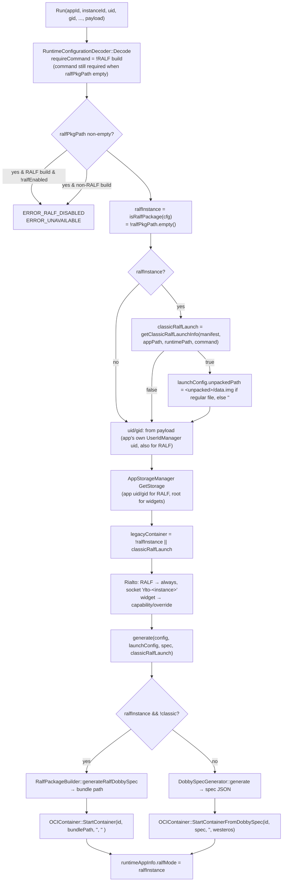
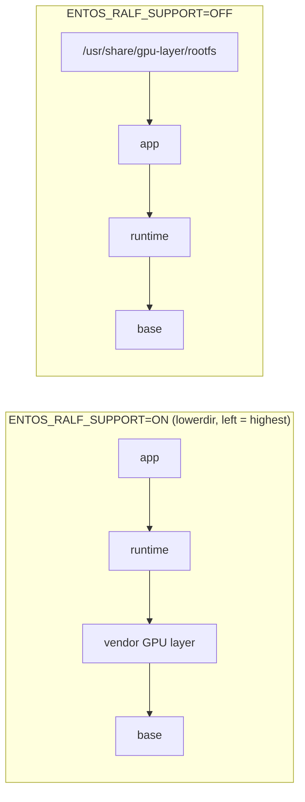
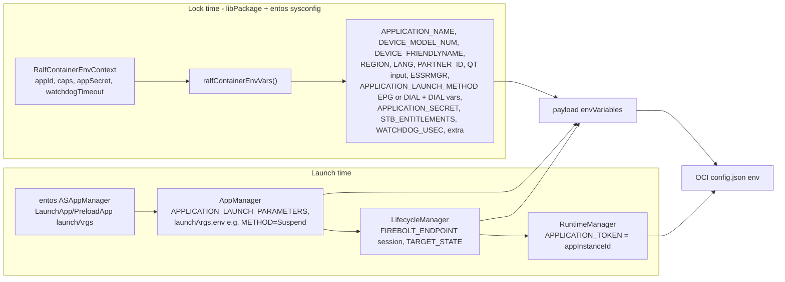

# 03 – entservices-appmanagers: RALF Changes

> **Branch:** `topic/RDKEMW-25785` · **Baseline:** `develop` @ `9815a6a37`
> RALF RuntimeManager code (`RuntimeManager/ralf/*`) already existed on `develop`
> (RDK generic RALF). This branch made it **coexist with EntOS widgets** and added the
> EntOS-specific behaviour. 19 files in plugin dirs, +1119 / −135.

## 1. Summary of changes per plugin

| Plugin | Files | What changed |
|--------|-------|--------------|
| **RuntimeManager** | `RuntimeManagerImplementation.{h,cpp}`, `DobbySpecGenerator.cpp`, `RuntimeConfiguration.cpp`, `CMakeLists.txt`, `ralf/*` | compile-time "everything is RALF" → **runtime dispatch on `ralfPkgPath`**; classic (base-free) RALF launch; `ralfEnabled` kill-switch; EntOS vendor GPU layer; secrets/env injection; safer manifest parsing; bundle dir modes |
| **PackageManager** | `CMakeLists.txt`, `PackageManager.md` | doc + clarified that `USE_LIBPACKAGE_RALF` is *not* the format switch (keep OFF with libpackage-sky). `getRuntimeConfig()` already copies `ralfPkgPath` – no code change needed |
| **AppStorageManager** | – (pre-existing) | `chown(baseStoragePath, -1, ralfGid)` under `RALF_PACKAGE_SUPPORT_ENABLED` |
| **AppManager** | – (pre-existing; branch removes 1 blank line) | `RALF_PACKAGE_SUPPORT_ENABLED` block re-asserts `userId/groupId` in the payload (see note in [06](06_EntOS_Ifdefs_and_NonEntOS_Protection.md#appmanager)) |
| **entos-appmanagers sysconfig** (`ref/entos-appmanagers`) | `DobbySpecGenerator.{h,cpp}`, `RDKAppManagersSysConfig.cpp` | `ralfContainerEnvVars(RalfContainerEnvContext)`: AI1 env set incl. secret, watchdog, device model, DIAL launch vars, launch method default; `stb-entitlements` token fix; DIAL block shared with widgets via `dialLaunchEnvVars()` (widget output unchanged) |

---

## 2. RuntimeManager: from compile-time to runtime dispatch

### 2.1 Before (develop)

```cpp
#ifdef RALF_PACKAGE_SUPPORT_ENABLED
    legacyContainer = false;               // EVERY app treated as RALF
    requiresRialto = true;
    rialtoSocket = "rlto-" + appInstanceId;
    getRalfUserInfo(uid, gid);             // EVERY app runs as 'ralf'
    ... generate() → always RalfPackageBuilder
#endif
```

A RALF-enabled build could not launch EntOS ZIP widgets at all.

### 2.2 After



| New/changed member | Purpose |
|--------------------|---------|
| `static bool isRalfPackage(const RuntimeConfiguration&)` | `!ralfPkgPath.empty()` – **sole discriminator**; returns `false` in non-RALF builds |
| `bool generate(..., bool classicRalfLaunch)` | choose OCI bundle vs classic spec |
| `static void cleanupRalfInstance(id, ralfMode)` | unmount overlay **only** for RALF OCI-bundle instances (classic RALF has none → `unmountOverlayfsIfExists` is a no-op) |
| `RuntimeAppInfo::ralfMode` | remembered per instance for Terminate/Kill/failure cleanup |
| `Configuration::ralfEnabled` (`"ralfEnabled"` in plugin config, default `true`) | runtime kill-switch |

### 2.3 Classic (base-free) RALF detection – `ralf::getClassicRalfLaunchInfo()`

Returns `true` only when **all** hold:

| Condition | Reason |
|-----------|--------|
| manifest has 1 or 2 entries | no base layer and at most one runtime |
| last entry `packageType == "application"` with non-empty `entryPoint` | must be an app |
| if 2 entries: first `packageType == "runtime"`; `entryPoint` absent or string | runtime + app |
| executable is relative, no `.`/`..` components | path-traversal guard |

Outputs: `appPath = app mount`, `runtimePath = runtime mount` **only if** the runtime has an
`entryPoint` (then `command = runtime entryPoint`), else `command = app entryPoint`.
The rewritten `launchConfig` is passed to `DobbySpecGenerator`, which bind-mounts `appPath` at
`/package` and `runtimePath` at `/runtime`.

### 2.4 `DobbySpecGenerator` changes (RuntimeManager)

```cpp
if (!runtimeConfig.unpackedPath.empty())           // classic RALF without data.img
    mounts.append(createPrivateDataMount(runtimeConfig));
...
if (!runtimeConfig.ralfPkgPath.empty()) {          // classic RALF only
    rdkPluginsObj["networking"]     = createNetworkPlugin(...);
    rdkPluginsObj["appservicesrdk"] = createAppServiceSDKPlugin(...);
}
```

### 2.5 OCI-bundle path changes (`RuntimeManager/ralf/*`)

| Function | Change | Gated by |
|----------|--------|----------|
| `RalfPackageBuilder::generateOCIRootfsPackage` | dropped uid/gid; EntOS: use the **shared vendor GPU layer** (`<bundleRoot>/vendor`, built once per process by `RalfVendorLayer::createShared()`, like AI1's `OCIVendorLayer`) and insert it directly above the `base` layer (or at the bottom if no base); remove bundle dir on failure | EntOS parts: `ENTOS_RALF_SUPPORT` |
| `generateOCIRootfs` | no chown; directories forced to `0755`; fails if mkdir fails | none (RALF) |
| `RalfOCIConfigGenerator::generateRalfOCIConfig` | new `addPackageSecretsToOCIConfig` (`runtimeSecrets.applicationSecret` → `APPLICATION_SECRET`, `credentialsManager`), new `addRuntimeEnvironmentToOCIConfig` (payload env vars → OCI env), EntOS `setLegacyProcessArgs` | secrets/env: none; args: `ENTOS_RALF_SUPPORT` |
| `applyRuntimeAndAppConfigToOCIConfig` | Rialto socket from `appConfig.mRialtoSocketPath` (was hard-coded `/tmp/rlto-<id>`); `APPLICATION_TOKEN=<appInstanceId>` (same as the classic widget spec; ASAppManager derives its AS token from it); widget `data.img` (`unpackedPath` regular file) loop-mounted at `/home/private` via the Dobby `storage` rdkPlugin (`addPrivateDataToOCIConfig`, AI1 `setPrivateDataMount` parity) | none |
| `saveOCIConfigToFile` | no chown; mode `0600` if secrets present else `0644`; debug dump redacts `APPLICATION_SECRET` | none |
| graphics `files[]` | EntOS: typed entries, only `type=="bind"` mounted (ro, bind, nosuid, nodev) exactly as configured – the former `libwayland-egl.so.1.20.0` → `.so.1` source rewrite was **removed**; library-version differences must be expressed in `vendor-gpu.json` (bind the soname the image ships and add `symlink` entries in the vendor layer, see `docs/VENDOR_GPU_CONFIG_PROCESSING.md`) | `ENTOS_RALF_SUPPORT` |
| graphics `devs[]` | EntOS: `glob()` patterns | `ENTOS_RALF_SUPPORT` |
| `prepareMergedRootfsMountTargets` | sorted creation of non-bind mount dirs + `/home` | none |
| `addBindMountToOCIConfig` | new `recursive/noSuid/noDev` params (defaults keep old `rbind`) | none |
| `parseRalPkgInfo` | strict validation, no partial append | none |
| `RalfConstants.h` | EntOS: GPU config `/etc/sky/aisettings.overrides/vendor-gpu.json`, bundle root `/run/sky/bundles/` | `ENTOS_RALF_SUPPORT` |
| `RalfVendorLayer` (**new**) | builds the shared `<bundleRoot>/vendor` from the GPU config (`file` copies, `symlink`s, `bind`/`socket` mount targets); `createShared()` builds it once per process and reuses it for every bundle | used only under `ENTOS_RALF_SUPPORT` (compiled always) |

#### Overlay layer order



#### Process args

| Build | `process.args` |
|-------|----------------|
| EntOS | `[base.entryPoint (init), <runtime/middle entryPoints…>, app.entryPoint?, app.entryArgs…]` – base with an `entryPoint` is **required**; the app entryPoint is optional when a runtime supplies the executable (AI1 parity, needed for a ZIP widget on a RALF runtime); at least one entry after the init is required |
| non-EntOS | each package's `entryPoint` and `entryArgs` appended in manifest order (unchanged) |

---

## 3. PackageManager

No code change was needed for RALF transport:

```cpp
// PackageManagerImplementation::getRuntimeConfig()
payload.SetString("appPath",     config.appPath);
payload.SetString("command",     config.command);
payload.SetString("runtimePath", config.runtimePath);
payload.SetString("ralfPkgPath", config.ralfPkgPath);
```

`USE_LIBPACKAGE_RALF` (default OFF) enables **generic libpackage** "companion runtime"
semantics: PackageManager itself locks `state.runtimeApp` after the app and unlocks it in
`Unlock()`. libpackage-sky resolves and locks runtimes **inside** `PackageImpl::Lock()`
(widget runtimes via `loadPackage`, RALF runtimes via `lockRuntime`, RALF deps via
`lockRecursive`), so enabling `USE_LIBPACKAGE_RALF` with libpackage-sky would double-lock.

---

## 4. Plugin configuration knobs

| Plugin | Key | Default | Effect |
|--------|-----|---------|--------|
| RuntimeManager | `ralfEnabled` | `true` | `false` → RALF launches rejected (`ERROR_RALF_DISABLED`) |
| libpackage (aisettings) | `.packages.mountsTmpDir` | `/var/run/sky/mounts` | libralf mount root |
| libpackage (aisettings) | `.packages.extractedTmpDir` | (existing) | RALF extraction fallback under `ralf/` |
| libpackage (aisettings) | XML-DSig CA enables/locations | (existing) | RALF verification bundle |
| libpackage (compile) | `RALF_PACKAGE_FILE_NAME` | `package.wgt` | RALF file name in the shared slot |
| RuntimeManager (compile) | `ENTOS_RALF_GPU_CONFIG_FILE` | `/etc/sky/aisettings.overrides/vendor-gpu.json` | EntOS GPU layer config |
| RuntimeManager (compile) | `ENTOS_RALF_BUNDLE_ROOT` | `/run/sky/bundles/` | EntOS OCI bundle root (shared vendor layer at `<root>/vendor`) |

---

## 5. Who owns which container environment variable

All package/platform policy comes from the **entos-appmanagers sysconfig** layer
(`DobbySpecGenerator::ralfContainerEnvVars()` for RALF-layered containers,
`buildEnvVars()` for widget specs). Per-launch values are added by the generic launch path and
replace lock-time values with the same name (`RuntimeConfigPayload::UpsertEnvironment` and
`RalfOCIConfigGenerator::addToEnvironment` both replace by key).



| Variable | AI1 source | AI2 source |
|----------|-----------|------------|
| `APPLICATION_NAME` | OCIBundleGenerator | sysconfig `ralfContainerEnvVars` |
| `APPLICATION_LAUNCH_PARAMETERS` | base64 launch args | AppManager `appendLaunchParametersEnv` (args from entos ASAppManager) |
| `APPLICATION_LAUNCH_METHOD` | launch params | sysconfig default `EPG`, `DIAL` from the gdial marker; preload `Suspend` via ASAppManager `launchArgs.env` |
| `APPLICATION_TOKEN` | launch token UUID | RuntimeManager `appInstanceId` (ASSecurityAgentServer `tokenFromAppInstanceId`) |
| `FIREBOLT_ENDPOINT` | firebolt session | LifecycleManager (`?session=<appInstanceId>`) |
| `DEVICE_*`, `PARTNER_ID`, `REGION`, `LANG` | SystemInfo | sysconfig |
| `APPLICATION_SECRET` | `IPackage::secret()` | sysconfig from `context.appSecret` (decoded at install/boot by libpackage-sky) |
| `WATCHDOG_USEC` | watchdog capability | sysconfig from `context.watchdogTimeout` |
| `STB_ENTITLEMENTS` | (not implemented in AI1 OCI) | sysconfig when caps contain `stb-entitlements` |
