# 04 – Sequence Diagrams

All diagrams reflect the code on `topic/RDKEMW-25785` (entservices-appmanagers) and
`topic/entos-ralf-support` (libpackage-sky). Participants:

| Alias | Component |
|-------|-----------|
| AM | AppManager (`AppManagerImplementation`) |
| LCM | LifecycleManager |
| PM | PackageManager (`PackageManagerImplementation`) |
| PI | libpackage-sky `PackageImpl` |
| PDB | libpackage-sky `PackageDatabase` |
| RH | libpackage-sky `RalfPackageHandler` |
| LR | libralf (`ralf::Package`, `ralf::PackageMount`) |
| SCP | `ISystemConfigProvider` (rdkappmanagers-sysconfig) |
| RM | RuntimeManager (`RuntimeManagerImplementation`) |
| RPB | `ralf::RalfPackageBuilder` / `RalfOCIConfigGenerator` |
| DSG | RuntimeManager `DobbySpecGenerator` |
| ASM | AppStorageManager |
| OCI | OCIContainer plugin → Dobby |

---

## 1. Boot / cache initialisation

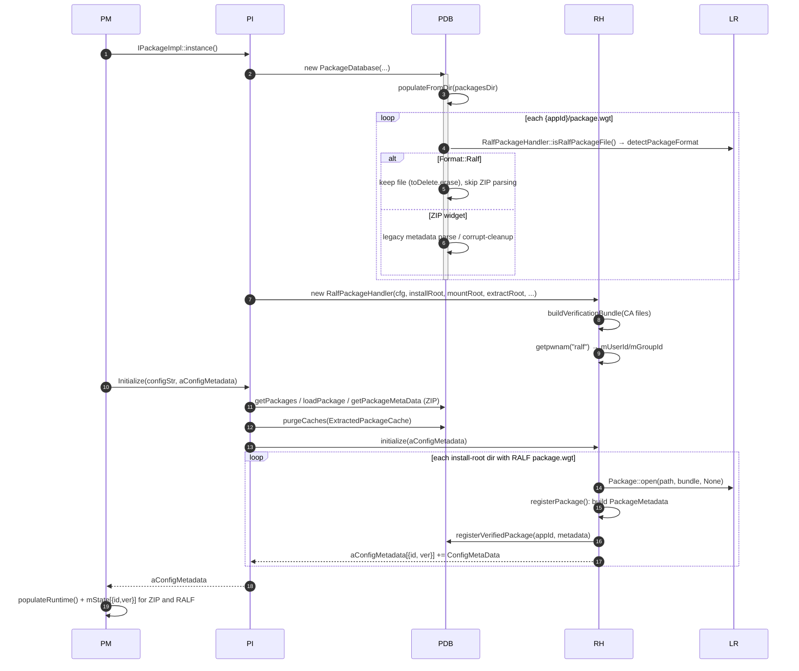

---

## 2. Install – RALF package

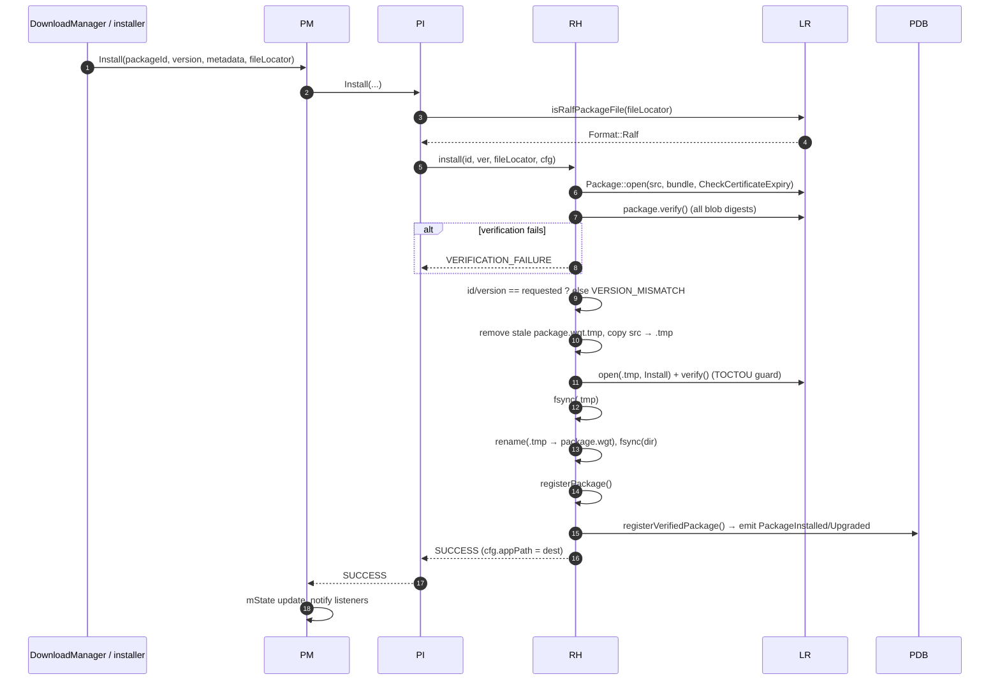

## 3. Install – ZIP widget (hardened, shared slot)

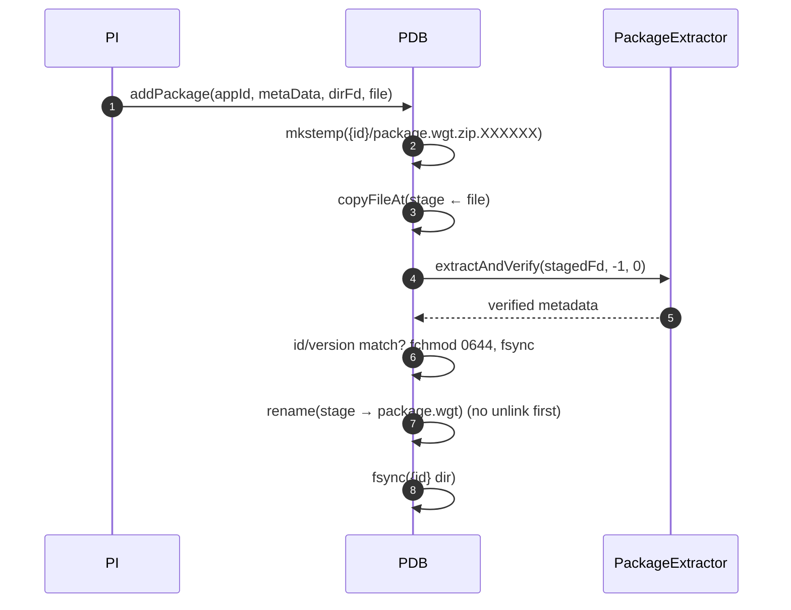

---

## 4. End-to-end launch – RALF app with base layer (OCI bundle mode)

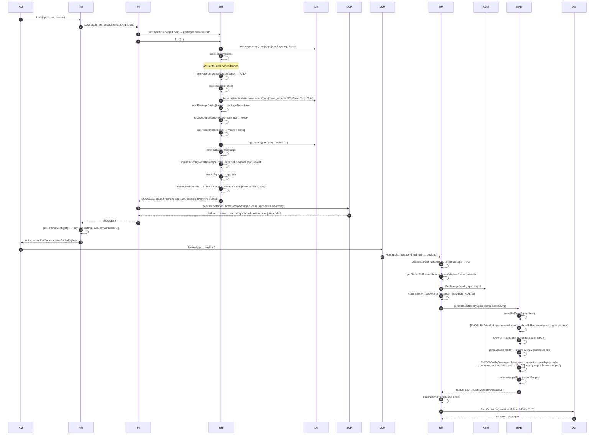

## 5. Launch – base-free RALF app (classic Dobby spec mode)

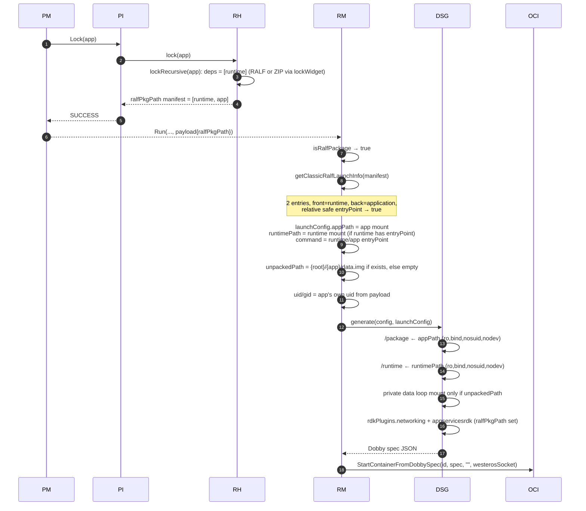

## 6. Launch – ZIP widget app with RALF runtime (YouTube + com.sky.cobalt)

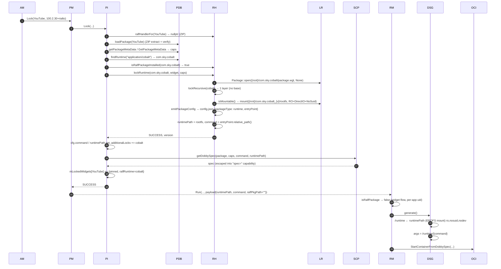

### 6b. ZIP widget app with a RALF runtime that depends on a base (Mode 3b, OCI bundle)

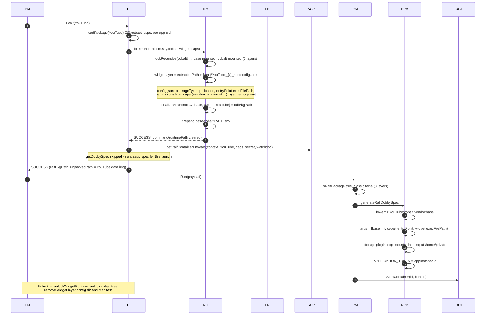

Failure variant – Cobalt cannot be mounted:

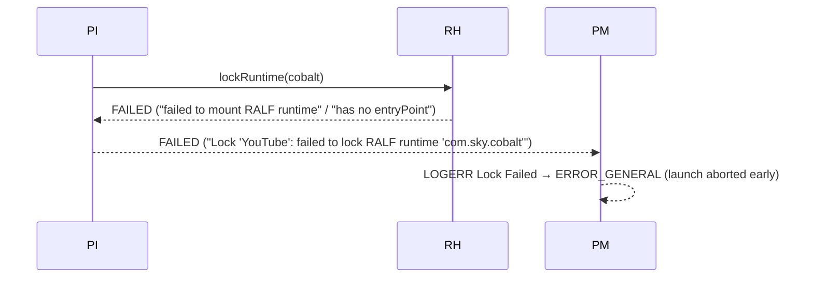

---

## 7. Terminate / container stop / unlock

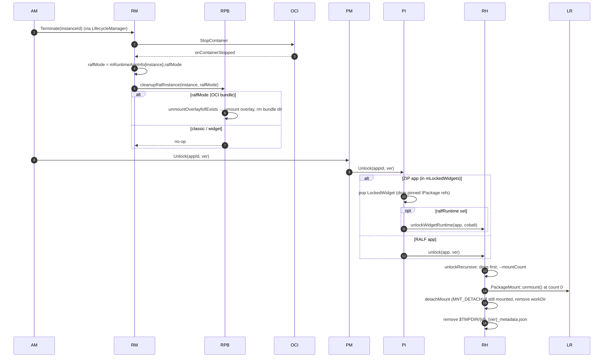

## 8. Upgrade while running

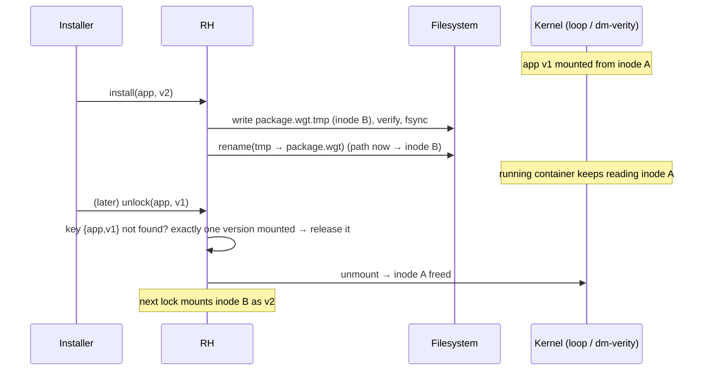

## 9. Uninstall

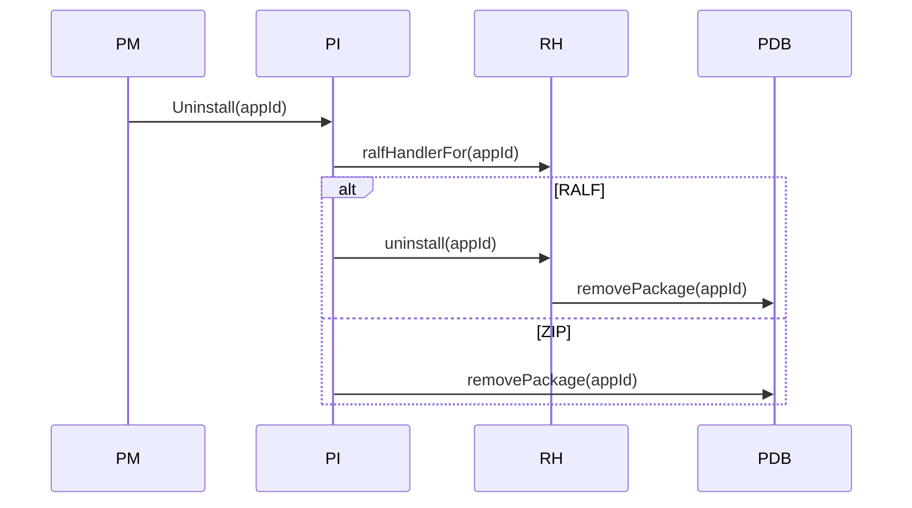

## 10. Kill-switch / unsupported build

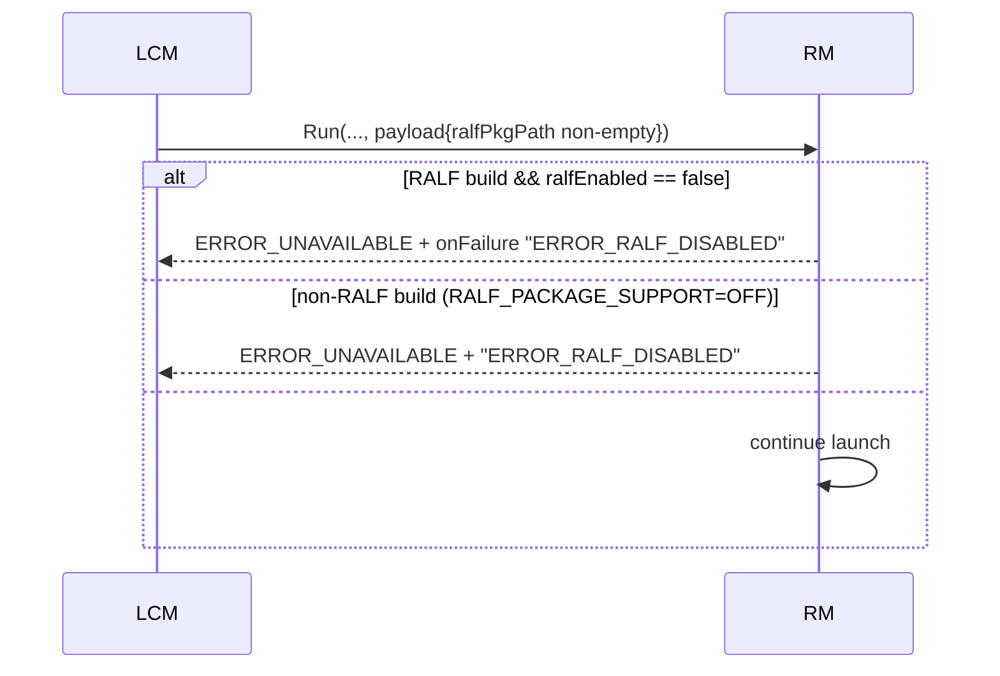
