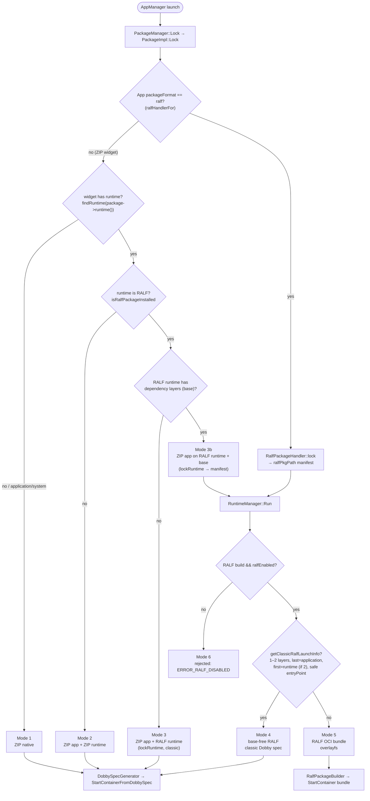
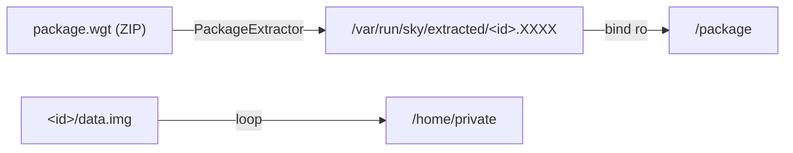
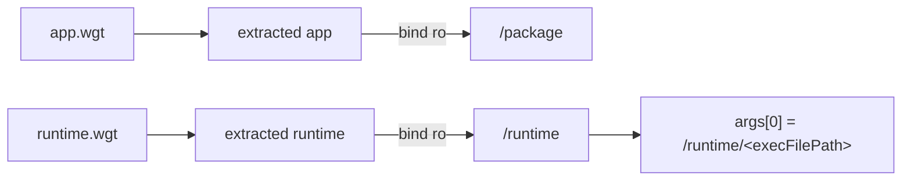
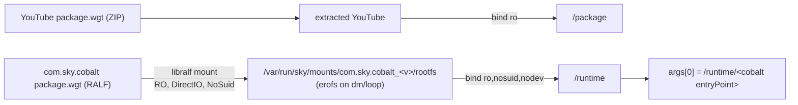
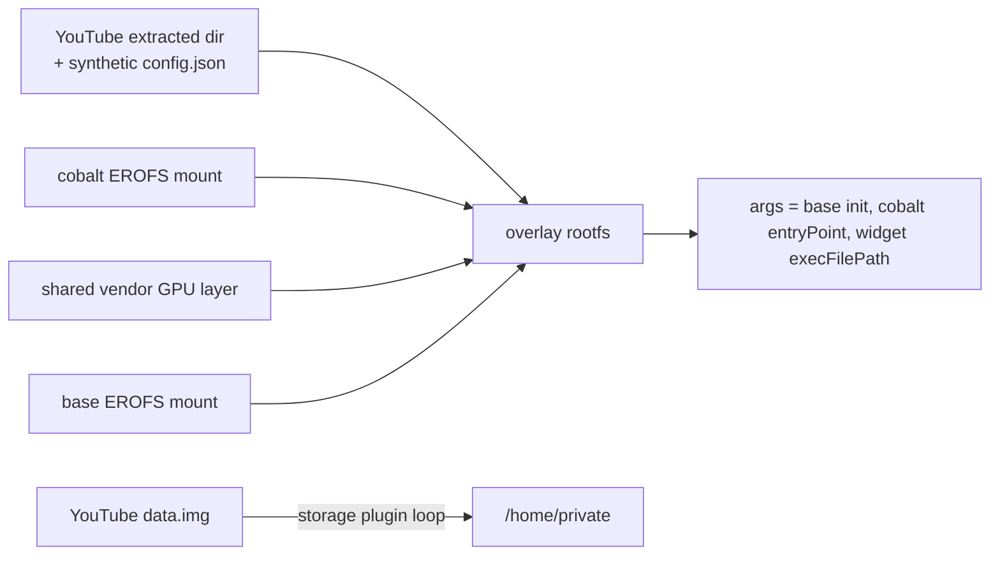
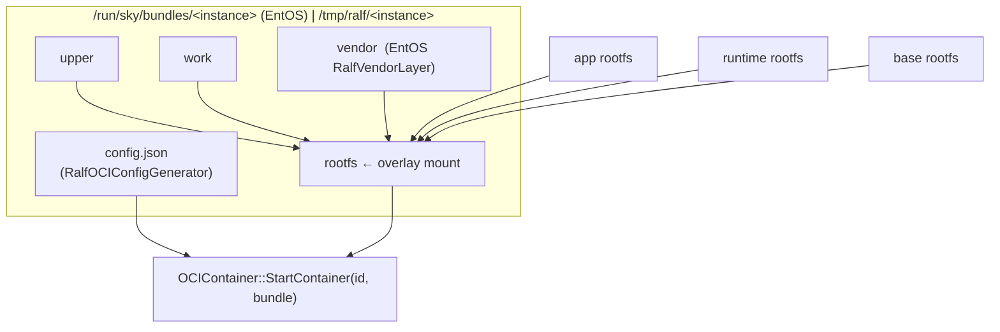
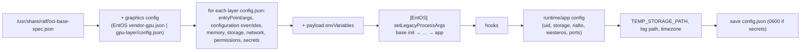

# 05 – Launch Modes

Seven distinct paths exist (Mode 3b added for ZIP apps on RALF runtimes with a base). Which one is used is decided by **(a)** what libpackage-sky puts in
`ConfigMetaData` at lock time and **(b)** `RuntimeManagerImplementation::Run()` at launch time.

## 1. Decision tree

## 2. Comparison matrix

| | **1 ZIP native** | **2 ZIP + ZIP runtime** | **3 ZIP + RALF runtime** | **4 base-free RALF** | **5 RALF OCI bundle** | **6 disabled** |
|---|---|---|---|---|---|---|
| Example | native EPG widget | HTML app on ZIP WPE runtime | YouTube widget on RALF `com.sky.cobalt` | RALF app + RALF/ZIP runtime, no base | RALF app + runtime + **base** | any RALF with `ralfEnabled=false` |
| App payload | extracted tmpfs | extracted tmpfs | extracted tmpfs | EROFS mount (or extraction fallback) | EROFS mount | – |
| Runtime payload | – | extracted tmpfs | **EROFS mount via libralf** | EROFS mount or ZIP extraction (`lockWidget`) | EROFS mount | – |
| `ralfPkgPath` | empty | empty | **empty** | manifest | manifest | manifest |
| `isRalfPackage()` | false | false | false | true | true | (true) |
| uid/gid | per-app | per-app | per-app | per-app | per-app | – |
| Spec builder | DobbySpecGenerator (+`spec=` from sysconfig) | same | same | DobbySpecGenerator (rewritten `launchConfig`) | `RalfOCIConfigGenerator` | – |
| `/package` | extracted app | extracted app | extracted app | app mount | (overlay rootfs `/`) | – |
| `/runtime` | – | extracted runtime | **runtime EROFS mount** | runtime mount (if runtime has entryPoint) | (overlay rootfs `/`) | – |
| Root filesystem | Dobby default | Dobby default | Dobby default | Dobby default | overlayfs `app:runtime:[vendor]:base` | – |
| Private data | loop mount `data.img` | loop mount | loop mount | loop mount if `<root>/<app>/data.img` exists | AppStorageManager path (+ widget `data.img` at `/home/private` in Mode 3b) | – |
| Westeros socket | via Dobby | via Dobby | via Dobby | via Dobby | not passed (RALF config mounts it) | – |
| Rialto | capability/override | same | same | always, `rlto-<instance>` | always, `rlto-<instance>` | – |
| OCIContainer call | `StartContainerFromDobbySpec` | same | same | same | `StartContainer(bundle)` | none |
| Cleanup at stop | – | – | – | `cleanupRalfInstance` no-op | unmount overlay + rm bundle | – |
| Unlock | pinned widgets | pinned widgets | pinned widgets **+ RalfPackageHandler::unlock(runtime)** | `unlockRecursive` | `unlockRecursive` | – |

## 3. Mode details

### Mode 1 – ZIP native widget (unchanged)

### Mode 2 – ZIP app + ZIP runtime (unchanged)

### Mode 3 – ZIP app + RALF runtime without base (`lockRuntime`, classic)

Requirements: the RALF runtime's `mimeType` must match the widget's runtime
(`application/X` ↔ `runtime/X`), it must declare an `entryPoint`, and its files must be readable
by the widget's per-app uid (EROFS file ownership comes from the image).

### Mode 3b – ZIP app on a RALF runtime that depends on a base (OCI bundle)

Same as AI1: the runtime's base dependency makes the widget launch as an OCI bundle.

- Manifest `[base…, runtime, widget]` written by `RalfPackageHandler::lockRuntime()`; the
  widget layer config gets `packageType: application`, its `execFilePath` as optional entryPoint,
  permissions mapped back from widget capabilities and the `sys-memory-limit`.
- Env comes from sysconfig `getRalfContainerEnvVars(context)` (no classic Dobby spec is built).
- The widget keeps its per-app uid; `unlockWidgetRuntime()` cleans up at unlock.

### Mode 4 – base-free RALF (classic Dobby spec)

```mermaid
flowchart LR
    APP["app RALF"] -->|mount| AM["&lt;mnt&gt;/app_v/rootfs"] -->|bind ro| P["/package"]
    RTP["runtime RALF or ZIP"] -->|mount / extract| RM2["&lt;mnt&gt;/rt_v/rootfs<br/>or extracted dir"] -->|bind ro| RT["/runtime"]
    MAN["manifest [runtime, app]"] -.-> GC["getClassicRalfLaunchInfo"]
    GC -.-> DSG["DobbySpecGenerator<br/>+ networking + appservicesrdk plugins"]
```

### Mode 5 – RALF OCI bundle (overlayfs)

`RalfOCIConfigGenerator::generateRalfOCIConfig()` pipeline:

### Mode 6 – disabled

RuntimeManager returns `Core::ERROR_UNAVAILABLE` and notifies `ERROR_RALF_DISABLED` when a payload
carries `ralfPkgPath` but either the build lacks `RALF_PACKAGE_SUPPORT` or the plugin config has
`"ralfEnabled": false`. libpackage-sky still mounts/unmounts normally; only the launch is refused.

## 4. Which mode will my package use? – quick checklist

1. Is the **app** a RALF file? (`ralf::Package::detectPackageFormat`) → if no: Mode 1/2/3.
2. ZIP app: does its runtime id resolve (`application/X` → package with `runtime/X`)? Is that
   package RALF? → Mode 3, or Mode 3b if the runtime has dependency layers (e.g. a base).
3. RALF app: how many entries in `$TMPDIR/<id>_<ver>_metadata.json`?
   - ≥3, or first entry `packageType: base` → Mode 5.
   - 1 (app) or 2 (`runtime` then `application`) with safe relative `entryPoint` → Mode 4.
4. EntOS Mode 5 additionally requires the first manifest entry to be a `base` with an
   `entryPoint` (init) – otherwise `RALF launch requires a base package with an init entryPoint`.
