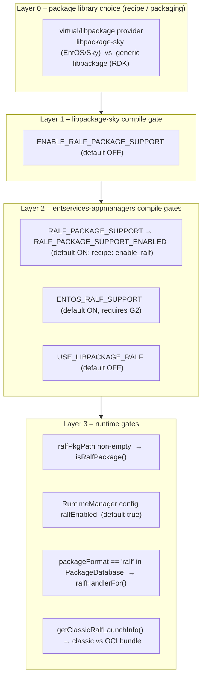
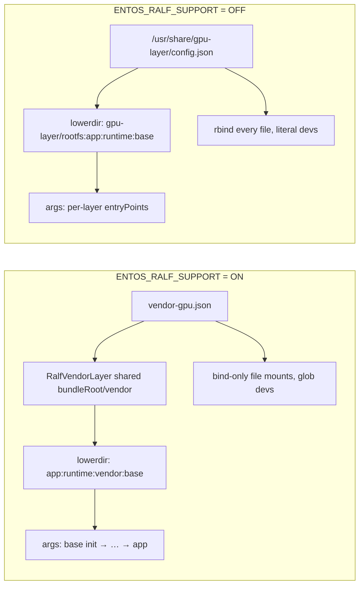
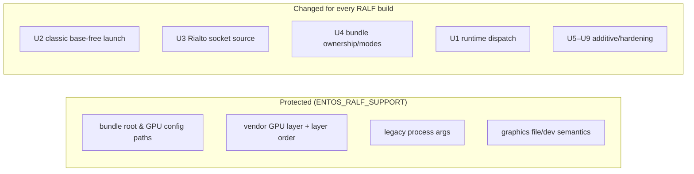

# 06 – EntOS-specific `#ifdef`s and How They Protect Non-EntOS RALF Usage

RALF support in `RuntimeManager/ralf/*` originally came from **RDK generic RALF** (develop).
EntOS needed different paths, a vendor GPU layer, different process args and different
graphics-config semantics. This document lists **every** compile-time and runtime gate, what
each one protects, and – just as important – **what is not protected**.

---

## 1. The gate hierarchy



| Gate | Defined in | Scope | Default | Protects |
|------|-----------|-------|---------|----------|
| `ENABLE_RALF_PACKAGE_SUPPORT` | `ref/libpackage-sky/CMakeLists.txt` | libPackage.so | **OFF** | EntOS widget-only builds from libralf and from any RALF code path |
| `RALF_PACKAGE_SUPPORT_ENABLED` | `RuntimeManager/CMakeLists.txt`, `AppStorageManager/CMakeLists.txt` (`add_definitions`, directory scope) | RuntimeManager, AppStorageManager | **ON** (`RALF_PACKAGE_SUPPORT` option) | Non-RALF builds from `ralf/*.cpp`, jsoncpp link, OCI bundle code |
| `ENTOS_RALF_SUPPORT` | `RuntimeManager/CMakeLists.txt` (`target_compile_definitions PRIVATE`) | RuntimeManager implementation lib only | **ON** | **Non-EntOS RALF behaviour** (paths, GPU layer, args, graphics semantics) |
| `ENTOS_RALF_GPU_CONFIG_FILE` / `ENTOS_RALF_BUNDLE_ROOT` | `RalfConstants.h` `#ifndef` | RuntimeManager | Sky paths | Lets an EntOS integrator override paths without code edits |
| `USE_LIBPACKAGE_RALF` | `PackageManager/CMakeLists.txt` | PackageManager | **OFF** | Generic-libpackage companion runtime locking (not needed for libpackage-sky) |
| `ralfEnabled` | RuntimeManager plugin config | runtime | `true` | Field kill-switch for RALF launches |

---

## 2. `ENTOS_RALF_SUPPORT` – every site

### 2.1 Build wiring

```cmake
option(RALF_PACKAGE_SUPPORT "Enable Ralf Package Support in Runtime Manager" ON)
option(ENTOS_RALF_SUPPORT  "Build a legacy-style vendor GPU layer for EntOS RALF" ON)
if(ENTOS_RALF_SUPPORT AND NOT RALF_PACKAGE_SUPPORT)
    message(FATAL_ERROR "ENTOS_RALF_SUPPORT requires RALF_PACKAGE_SUPPORT")
endif()
...
if(ENTOS_RALF_SUPPORT)
    find_package(LibXml2 REQUIRED)
    target_compile_definitions(${PLUGIN_IMPLEMENTATION} PRIVATE ENTOS_RALF_SUPPORT)
    target_include_directories(${PLUGIN_IMPLEMENTATION} PRIVATE ${LIBXML2_INCLUDE_DIRS})
    target_link_libraries(${PLUGIN_IMPLEMENTATION} PRIVATE LibXml2::LibXml2)
endif()
```

`PRIVATE` scoping means the macro never leaks into other plugins or into the
`RuntimeManager` front-end module.

### 2.2 Site-by-site behaviour

| # | File / function | `ENTOS_RALF_SUPPORT` ON (EntOS) | OFF (RDK generic, = develop behaviour) |
|---|-----------------|--------------------------------|-----------------------------------------|
| 1 | `RalfConstants.h` – `RALF_GRAPHICS_LAYER_CONFIG` | `ENTOS_RALF_GPU_CONFIG_FILE` = `/etc/sky/aisettings.overrides/vendor-gpu.json` | `/usr/share/gpu-layer/config.json` |
| 2 | `RalfConstants.h` – `RALF_APP_ROOTFS_DIR` | `ENTOS_RALF_BUNDLE_ROOT` = `/run/sky/bundles/` | `/tmp/ralf/` |
| 3 | `RalfPackageBuilder::generateOCIRootfsPackage` – layer seed | shared `RalfVendorLayer::createShared(<bundleRoot>/vendor, gpuConfig)` (built once per process, AI1 parity); start with empty lowerdir list | lowerdir starts with `/usr/share/gpu-layer/rootfs` (prebuilt GPU layer, top priority) |
| 4 | same – loop | inserts `vendor` **just above the first `base` layer** encountered (reverse iteration) | plain `app:runtime:…:base` after the GPU layer |
| 5 | same – after loop | if no `base`, append `vendor` at the bottom | – |
| 6 | same – on failure | `removeDirectoryRecursively(<bundle root>/<instance>)` | no cleanup (develop behaviour) |
| 7 | `RalfOCIConfigGenerator::generateRalfOCIConfig` – collect configs | keeps every layer `config.json` in `packageConfigs` | – |
| 8 | same – process args | `setLegacyProcessArgs()`: `[base.entryPoint, middle…, app.entryPoint, app.entryArgs…]`; **fails** without a base init | per-layer `entryPoint`/`entryArgs` appended in manifest order |
| 9 | `applyGraphicsConfigToOCIConfig` – `files[]` | typed entries; only `type=="bind"` mounted `ro,bind,nosuid,nodev` (non-recursive) with the configured source; `file`/`symlink` handled by `RalfVendorLayer` (no source rewriting – library versions are a `vendor-gpu.json` concern) | every `{source,destination}` becomes an `rbind` (rw) mount |
| 10 | `addDeviceNodeEntriesToOCIConfig` – `devs[]` | `glob()` each pattern (e.g. `/dev/dri/*`) | literal paths |



### 2.3 Tests

| File | Gate | Note |
|------|------|------|
| `Tests/L0Tests/CMakeLists.txt` | `option(ENTOS_RALF_SUPPORT ... OFF)` | **L0 tests build the non-EntOS variant by default** → generic RALF behaviour stays regression-tested |
| `Tests/L0Tests/RuntimeManager/RuntimeManagerTest.cpp` | `#ifdef ENTOS_RALF_SUPPORT` | `Test_Ralf_GetClassicRalfLaunchInfo` etc. only in EntOS builds |
| `Ralf_OCIConfigGeneratorTests.cpp` | `#ifdef ENTOS_RALF_SUPPORT` | EntOS-only graphics tests |
| `Tests/L1Tests/CMakeLists.txt` | `PLUGIN_RALF` | compiles `ralf/*.cpp` directly without `RALF_PACKAGE_SUPPORT` |

---

## 3. `RALF_PACKAGE_SUPPORT_ENABLED` – every site

| File | Site | ON | OFF |
|------|------|----|-----|
| `RuntimeManagerImplementation.cpp` | includes | `ralf/RalfPackageBuilder.h`, `ralf/RalfSupport.h` | – |
| | ctor / `Configure` | `mRalfEnabled` from `"ralfEnabled"` | – |
| | `isRalfPackage()` | `!ralfPkgPath.empty()` | always `false` |
| | `generate()` | OCI bundle when RALF & !classic | DobbySpecGenerator only |
| | `cleanupRalfInstance()` | unmount overlay if `ralfMode` | no-op |
| | `Run()` decode | `requireCommand=false` (decoder still requires command when `ralfPkgPath` empty) | `requireCommand=true` |
| | `Run()` gate | reject if `!mRalfEnabled` | reject any `ralfPkgPath` |
| | `Run()` classic detection | `getClassicRalfLaunchInfo()` | – |
| | `Run()` uid | payload uid (app's own uid) for every container; the former `getRalfUserInfo()` override was removed | – |
| `RuntimeManagerImplementation.h` | `Configuration::ralfEnabled`, `mRalfEnabled` | present | absent |
| `AppStorageManager/RequestHandler.cpp` | includes + `chown(base, -1, ralfGid)` | `ralf` group on storage base | – |
| `AppManager/AppManagerImplementation.cpp` <a id="appmanager"></a> | re-set `userId/groupId` in payload | see finding F6 | – |

## 4. libpackage-sky gates

libpackage-sky **is** the EntOS (Sky) package library, so it has no `ENTOS_*` macro. Its single
gate protects **EntOS widget-only** products:

| Site | Effect when `ENABLE_RALF_PACKAGE_SUPPORT` OFF |
|------|-----------------------------------------------|
| `CMakeLists.txt` | no `find_package(libralf)`, no `RalfPackageHandler.cpp`/`RalfCapabilityConverter.cpp`, no `-lralf` |
| `RalfPackageHandler.h` | inline stub: `isRalfPackageFile()` → `false`, all ops `FAILED`, never instantiated |
| `PackageImpl.cpp` ctor | `mRalfPackageHandler` stays `nullptr` → every dispatch `if (mRalfPackageHandler && …)` falls through to the unchanged widget code |
| `PackageDatabase.cpp::populateFromDir` | RALF-preservation block compiled out (a RALF file would be treated as a corrupt widget, as before) |

Changes in libpackage-sky that are **not** behind the gate (affect widget-only builds too):
- ZIP install now stage → verify → fsync → rename (safer; no functional change on success).
- `IPackageDatabase::getPackageVersion()` removed; `registerVerifiedPackage()` and
  `ISystemConfigProvider::getRalfContainerEnvVars()` added **with default implementations**.
- `IPackageManagerConfig::getMountsTmpDir()` added as **pure virtual** (all implementors/mocks must add it).
- `PackageImpl` methods now take `mOperationLock` (recursive mutex) – serialises Install/Lock/Unlock/metadata queries.

Non-EntOS RDK products use **generic `ref/libpackage`** (`RalfPackageImpl`), which is untouched.

---

## 5. Protection matrix – build configurations

| Configuration | libpackage-sky RALF | `RALF_PACKAGE_SUPPORT` | `ENTOS_RALF_SUPPORT` | Result |
|---------------|---------------------|------------------------|----------------------|--------|
| **A. EntOS widget-only** | OFF | OFF | must be **OFF** explicitly | ✅ identical to pre-RALF – **but see F1: configure fails if ENTOS left at default ON** |
| **B. EntOS with RALF** | ON | ON | ON (default) | ✅ intended EntOS product |
| **C. RDK generic RALF (non-EntOS)** | n/a (generic libpackage) | ON | must be **OFF** explicitly | ⚠ EntOS-gated code protected; ungated changes in §6 apply |
| **D. RDK generic RALF, flag forgotten** | n/a | ON | ON (default) | ❌ EntOS paths/GPU-layer/args used on a non-EntOS device |
| **E. L0 tests** | n/a | defined | OFF (test default) | ✅ non-EntOS behaviour exercised |

---

## 6. What is **not** protected by `ENTOS_RALF_SUPPORT`

These changes on this branch are gated only by `RALF_PACKAGE_SUPPORT_ENABLED` (or not at all)
and therefore **also change behaviour for non-EntOS RALF builds** compared with `develop`:

| # | Change | Non-EntOS impact | Risk |
|---|--------|------------------|------|
| U1 | Runtime dispatch on `ralfPkgPath` instead of "everything is RALF" | Widgets in a RALF build now use DobbySpecGenerator + per-app uid instead of the RALF path | Low – fixes previously broken mixed builds; RALF packages still dispatched (generic libpackage sets `ralfPkgPath`) |
| U2 | **Classic (base-free) RALF launch** via `getClassicRalfLaunchInfo()` | A RALF app with 1–2 layers (`[runtime, application]` or `[application]`) and no base now launches with a **classic Dobby spec** instead of an OCI bundle | **Medium–High** if the RDK layout uses the GPU layer as implicit base and ships apps without a base dependency |
| U3 | Rialto socket from `mRialtoSocketPath` | `RIALTO_SOCKET_PATH` + bind only if a Rialto session was created; develop always injected `/tmp/rlto-<id>` | Medium when `ENABLE_RIALTO` is off and RALF Rialto was expected to self-manage |
| U4 | No chown of bundle dirs/`config.json`; dirs `0755`, config `0644`/`0600` | Bundle files owned by root instead of app uid | Low–Medium (depends on Dobby/crun reading as root) |
| U5 | `prepareMergedRootfsMountTargets` creates sorted non-bind dirs + `/home` | Extra empty dirs in upper layer | Low |
| U6 | Secrets (`runtimeSecrets`) and payload `envVariables` injected into OCI env | Additive – only when present | Low |
| U7 | `parseRalPkgInfo` strict validation | Malformed manifests now fail instead of partially parsing | Low (correctness) |
| U8 | `addBindMountToOCIConfig` new params | Defaults reproduce old `rbind` | None |
| U9 | `DobbySpecGenerator`: networking + appservicesrdk plugins when `ralfPkgPath` set; private-data mount skipped when `unpackedPath` empty | Only reachable via classic RALF (U2) / empty unpackedPath | Low |
| U10 | `RalfVendorLayer.cpp` compiled in every RALF build | Dead code when ENTOS OFF | None |



---

## 7. Findings and recommendations

| ID | Finding | Evidence | Recommendation |
|----|---------|----------|----------------|
| **F1** | `ENTOS_RALF_SUPPORT` defaults **ON** while `recipe.bb` never sets it. With `ralfsupport` absent the recipe passes `-DRALF_PACKAGE_SUPPORT=OFF` → `FATAL_ERROR "ENTOS_RALF_SUPPORT requires RALF_PACKAGE_SUPPORT"` | `RuntimeManager/CMakeLists.txt` L31–38; `recipe.bb` L93 | Use `cmake_dependent_option(ENTOS_RALF_SUPPORT … ON "RALF_PACKAGE_SUPPORT" OFF)` or default OFF and set `-DENTOS_RALF_SUPPORT=ON` from an EntOS distro feature |
| **F2** | Non-EntOS RALF builds get EntOS behaviour unless they remember `-DENTOS_RALF_SUPPORT=OFF` (config D) | same | Default OFF; enable explicitly for EntOS (opt-in is the safe direction for a vendor-specific flag) |
| **F3** | `ENTOS_RALF_SUPPORT` requires and links **LibXml2**, but no RuntimeManager source includes libxml2 | `grep libxml RuntimeManager/` → CMake only | Drop the dependency, or add the code that needs it |
| **F4** | Classic RALF launch (U2) is not EntOS-gated | `RuntimeManagerImplementation::Run`, `RalfSupport.cpp::getClassicRalfLaunchInfo` | Gate under `ENTOS_RALF_SUPPORT` or a config key (e.g. `ralfClassicLaunch`), or confirm RDK RALF apps always carry a base |
| **F5** | Rialto socket injection changed for all RALF builds (U3) | `applyRuntimeAndAppConfigToOCIConfig` | Keep the old hard-coded path under `#ifndef ENTOS_RALF_SUPPORT` if RDK relies on it |
| **F6** | `AppManager/CMakeLists.txt` never defines `RALF_PACKAGE_SUPPORT_ENABLED` (`add_definitions` is directory-scoped to RuntimeManager/AppStorageManager) → the AppManager block is compiled out | `grep RALF AppManager/CMakeLists.txt` → none | Either wire the define for AppManager or remove the dead block |
| **F7** | ~~`getRalfContainerEnvVars()` not implemented~~ – **corrected**: it was implemented on `topic/RDKEMW-25785` (an earlier search missed it) and has now been extended with a `RalfContainerEnvContext` (secret, watchdog, DIAL, device model, `stb-entitlements` fix) | `rdkappmanagers-sysconfig/DobbySpecGenerator.cpp` | Closed |
| **F9** | Changes on this branch that apply to **every** RALF build (not EntOS-gated): RALF apps now run with their own uid (no shared `ralf` user), OCI configs carry `APPLICATION_TOKEN`, widget `data.img` storage plugin, optional app entryPoint in legacy args (EntOS-only function) | `RuntimeManagerImplementation::Run`, `RalfOCIConfigGenerator` | Non-EntOS RDK products relying on the shared `ralf` user must provide the uid via the payload |
| **F8** | `USE_LIBPACKAGE_RALF=ON` with libpackage-sky can double-lock runtimes (PackageManager locks `state.runtimeApp` while `PackageImpl::Lock` already locked the runtime) | `PackageManagerImplementation::Lock/Unlock` | Keep OFF for libpackage-sky (documented in CMake comment) |
