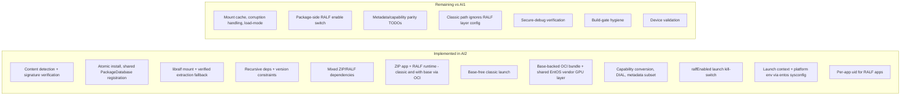
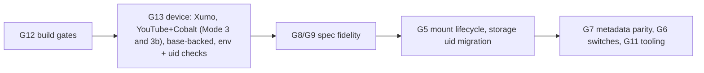

# 08 – Remaining Work for RALF App Support (vs legacy appserviced)

> **AI1 / legacy:** `ref/legacyappserviced` (`main` @ `49ebeba`) – `RDK/AppManager/*`
> **AI2 / current:** `entservices-appmanagers` (`topic/RDKEMW-25785`) + `ref/libpackage-sky`
> (`topic/entos-ralf-support`) + `ref/entos-appmanagers` (sysconfig)
>
> Source-level comparison. "Done" means implemented in code, not validated on a device.

## 1. Status at a glance

## 2. Remaining items

| # | Area | AI1 (legacy) behaviour | AI2 today | What remains | Priority |
|---|------|------------------------|-----------|--------------|----------|
| G1 | **Launch context in RALF containers** | `OCIBundleGenerator::populateEnvironment` sets launch params/method/token, firebolt, device, partner, secret, watchdog, package env | **Closed (code)** – entos sysconfig `ralfContainerEnvVars(RalfContainerEnvContext)` emits `APPLICATION_NAME`, `DEVICE_MODEL_NUM`, `DEVICE_FRIENDLYNAME`, `REGION`, `LANG`, `PARTNER_ID`, `APPLICATION_LAUNCH_METHOD` (EPG default, DIAL from the gdial marker), DIAL vars, `APPLICATION_SECRET` (decoded at install), `STB_ENTITLEMENTS`, `WATCHDOG_USEC`; per-launch `APPLICATION_LAUNCH_PARAMETERS` (AppManager, from ASAppManager launchArgs), preload `Suspend` (launchArgs.env), `FIREBOLT_ENDPOINT` (LifecycleManager), `APPLICATION_TOKEN=<appInstanceId>` (RuntimeManager) | Device check of env in `/tmp/generatedRalfSpec`; `PLATFORM_VENDOR` is commented out for widgets too | Done |
| G2 | **Platform env provider** | Built into `OCIBundleGenerator` | **Closed** – implemented in `rdkappmanagers-sysconfig` (the earlier "not implemented" note was wrong) and extended with package context | – | Done |
| G3 | **ZIP app + RALF runtime that depends on a base layer** | Implicit runtime dependency → runtime's base → OCI bundle | **Closed (code)** – `RalfPackageHandler::lockRuntime()` writes a manifest `[base…, runtime, widget]` with a synthetic widget layer config (permissions from capabilities, memory limit) and routes to the OCI bundle (Mode 3b); widget `data.img` mounted at `/home/private` | Device test with a Cobalt build that has a base; classic widget spec features (DIAL/MAPI/TSB/multicast mounts) not reproduced in the OCI path | P1 (validation) |
| G4 | **User/group model** | Per-app uid | **Closed** – RALF apps run as their own `UserIdManager` uid (child apps: parent's uid); shared `ralf` user removed from libpackage-sky and RuntimeManager | Check AppStorageManager ownership/migration of storage created under the old `ralf` uid on devices that already ran RALF apps | P1 (migration) |
| G5 | **Mount lifecycle** | `MountedPackagesManager`: mount cache with `lastUsed`, `trimUnusedMounts()`, `purge()`, startup cleanup of stale mounts, **`CorruptionDetected` event** → package removal, `loadMode` auto/mount/extract, mount threshold | Mount per lock, unmount at last unlock (no cache); stale mount detached lazily per key; no corruption event; mount always tried first | Decide on mount cache (launch latency vs memory); add dm-verity/IO corruption → mark package corrupt / reinstall; startup sweep of `mountsTmpDir`; optional load-mode setting | **P1** |
| G6 | **Package-side enable switches** | `.packages.ralf.enable`, `.packages.ralf.useRalfUtilsForWidgets`, `.apps.ociBundleGenerator.enable`, `.apps.ociBundleGenerator.mapHostCACertificates` | Compile-time `ENABLE_RALF_PACKAGE_SUPPORT`; RuntimeManager `ralfEnabled` (launch only). Install/detect/mount cannot be disabled at runtime; CA binds come from `oci-base-spec.json` unconditionally | Add libpackage runtime switch aligned with `ralfEnabled`; make CA mapping conditional on config + host path existence | **P2** |
| G7 | **Metadata / capability parity** | `RalfMetadataConverter` maps start timeout, game mode, age policy, marketplace intercept, picture mode, local-socket import/export ports, hole-punch protocols, post-intents / TSB / external storage / compositor / chromecast | Marked `TODO(RALF-AI1-PARITY)` in `PackageMetadata.h`, `ApplicationCapabilities.h`, `RalfPackageHandler.cpp` (tokens exist in `RalfCapabilityConverter` but no shared-model fields/consumers) | Add shared-model fields + consumers (AppManager/RuntimeManager), then map | **P1** |
| G8 | **OCI spec features from package model** | `doSpecAndRootfsGen`: network (WAN/LAN, IPv6, hole-puncher ports, inter-container ports), Thunder plugin, memory limits, private data plugin (`data.img` → `/home/private`), ethanlog levels, minidump, DIAL, MAPI, TSB, external storage, debug, perfetto | AI2 OCI path covers network (`urn:rdk:config:network`), memory, storage (AppStorageManager path), permissions (firebolt/thunder), Rialto, Westeros, logging path, timezone; DIAL/MAPI/TSB/ext-storage/minidump/ethanlog/perfetto not mapped | Inventory and map the required subset for OCI RALF launches | **P1** |
| G9 | **Classic (base-free) path fidelity** | Trad generator uses the normalised package (capabilities, launch context) | `getClassicRalfLaunchInfo` reads only `packageType`/`entryPoint`; RALF layer `urn:rdk:config:env`, permissions, network and `entryArgs` are not applied; spec built from payload capabilities | Map signed layer settings into the classic Dobby spec or document as unsupported | **P1** |
| G10 | **Secure-debug verification fallback** | `RalfPackageExtractor` retries with `ISecureDebugVerifier::openAndVerifyRalf` | Not implemented | Deferred until an authorised verifier exists; never a general bypass | Deferred |
| G11 | **Tooling** | Gateway `PackageManagerService` accepts `type=ralf`; `dumpsys` prints the mount cache | None equivalent | Add RALF to install tooling / diagnostics if needed | P2 |
| G12 | **Build-gate hygiene** (see [06](06_EntOS_Ifdefs_and_NonEntOS_Protection.md#7-findings-and-recommendations)) | n/a | `ENTOS_RALF_SUPPORT` default ON + recipe never sets it; classic launch not EntOS-gated; unused LibXml2; dead AppManager block | Fix F1–F6 | **P1** |
| G13 | **Device validation** | Shipped | Xumo (RALF) reported launching; YouTube + Cobalt fix untested on device; no base-layer package validated; top-18 app conversion not started; Softcat end-to-end untested | Execute the matrix: base-backed OCI, base-free, ZIP+RALF runtime, upgrade/uninstall while running, failure cleanup, top-18 apps, Softcat | **P0** |

## 3. Closed since the earlier parity report (`docs/AI1_AI2_RALF_PARITY.md`)

| Item | Status |
|------|--------|
| ZIP app → RALF runtime discovery **and** loading | **Closed** – `RalfPackageHandler::lockRuntime()`: classic `/runtime` without base (Mode 3), OCI bundle with base (Mode 3b); lock fails if the runtime cannot be mounted |
| Vendor GPU layer | **Aligned with AI1** – one shared layer built per process (`RalfVendorLayer::createShared`); the `libwayland-egl` source-rewrite workaround was removed (config-driven symlinks instead) |
| Mandatory `application/vnd.rdk.package.config.v1+json` per layer | **Relaxed** – `emitPackageConfig()` now accepts `FileNotFound` and synthesises `packageType`/`entryPoint`/`entryArgs` from verified metadata |
| Runtime with no executable in base-free set | Closed (classic detector omits `/runtime`, uses app entryPoint) |
| RALF MD5 in `listPackages` | Closed (`getPackageMd5` via shared PackageDatabase) |

## 4. Where AI2 is already ahead of AI1 (keep)

- Recursive dependency resolution with `VersionConstraint` (AI1 loads only the first dependency, no version checks).
- Mixed-format chains in both directions (RALF app → ZIP runtime via `lockWidget`; ZIP app → RALF runtime via `lockRuntime`).
- Install re-verifies the staged copy (TOCTOU) and renames atomically; ZIP install hardened the same way.
- Secrets-aware OCI config file permissions (`0600`) and redacted debug dumps.

## 5. Suggested order

