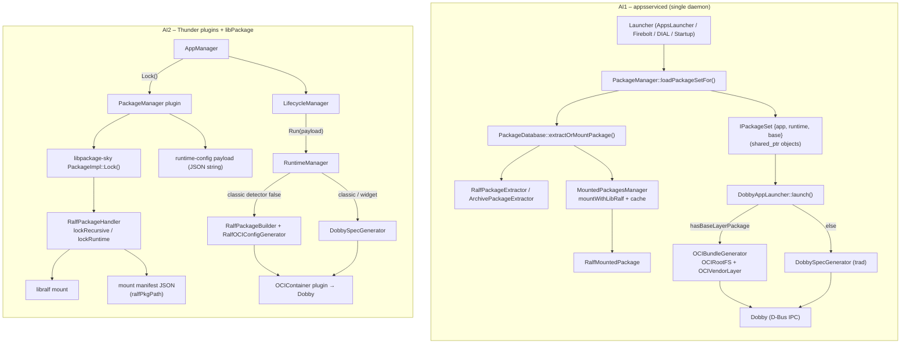
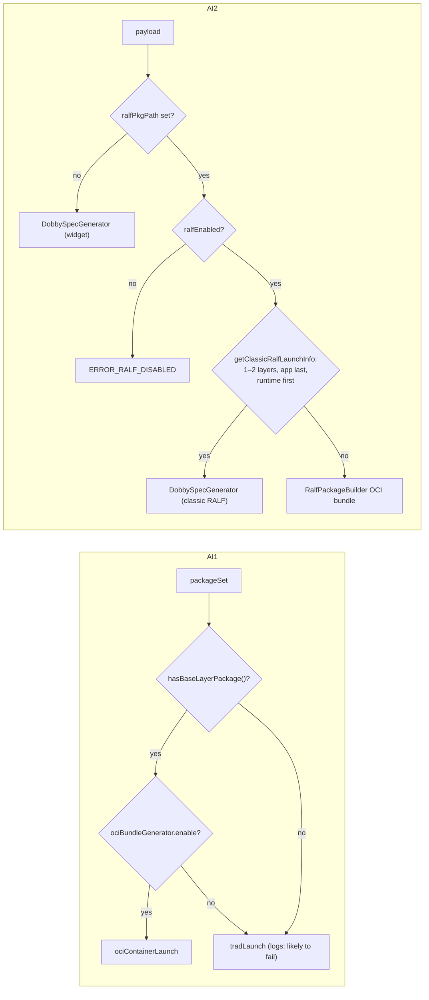
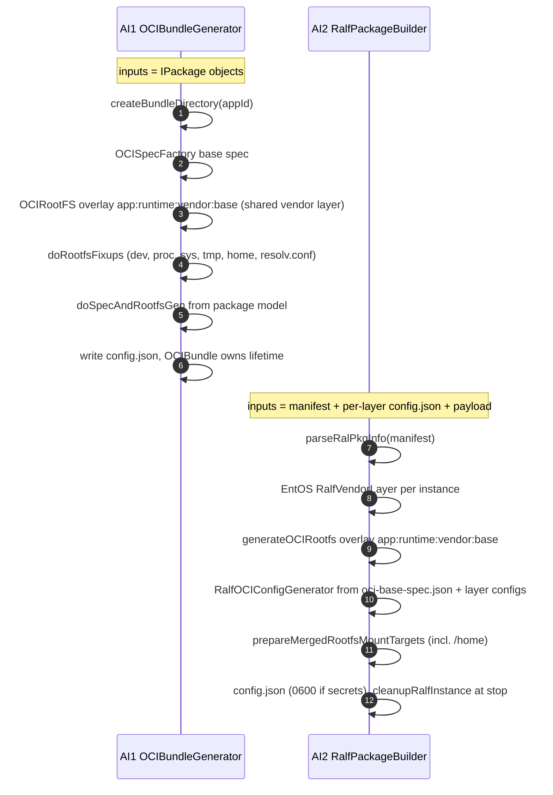
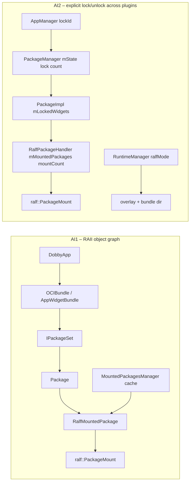

# 09 – RALF App Management and Launch: entservices-appmanagers vs legacy appserviced

> **AI1 / legacy:** `ref/legacyappserviced/RDK/AppManager` (`main` @ `49ebeba`)
> **AI2 / current:** `entservices-appmanagers` + `ref/libpackage-sky` + `ref/entos-appmanagers`

## 1. Architectural difference in one picture

**Core difference:** AI1 **normalises** RALF into its single package model (`RalfMetadataConverter`
→ `PackageMetadata` → `IPackage`) and passes **live package objects** to the launcher. AI2 keeps a
**parallel RALF path** in libpackage-sky and passes **strings** across plugin boundaries
(`ralfPkgPath` manifest + per-layer `config.json` + payload fields); RuntimeManager re-reads files
to rebuild the layer view.

## 2. Package management

| Aspect | AI1 (legacy appserviced) | AI2 (entservices-appmanagers + libpackage-sky) |
|--------|--------------------------|-----------------------------------------------|
| Integration style | RALF is a pluggable `IPackageExtractor` (`RalfPackageExtractor`) + `IMountedPackage` (`RalfMountedPackage`) inside the existing pipeline | Separate `RalfPackageHandler`; `PackageImpl` dispatches by `packageFormat=="ralf"` / content detection |
| Format detection | `ralf::Package::detectPackageFormat`; legacy EROFS widgets detected by `wgtEROFS` magic | `ralf::Package::detectPackageFormat` (no legacy EROFS widget support) |
| Enable switches | Runtime: `.packages.ralf.enable`, `.packages.ralf.useRalfUtilsForWidgets`, `.packages.erofsWidgets.*`, `.apps.ociBundleGenerator.enable` | Compile: `ENABLE_RALF_PACKAGE_SUPPORT`; runtime: RuntimeManager `ralfEnabled` (launch only) |
| libralf for ZIP widgets | Optional (`useRalfUtilsForWidgets`) | Never – ZIP widgets always use `PackageExtractor` |
| Verification | `Package::open(fd, bundle)`; optional secure-debug retry (`openAndVerifyRalf`) | `Package::open(path, bundle, flags)`; `Installed` (no expiry) / `Inspect` / `Install` (+`verify()`); no secure-debug |
| Install | `PackageInstaller` → extractor verify → `PackageDatabase` add | `RalfPackageHandler::install`: verify → stage `.tmp` → **re-verify staged** → fsync → `rename` → `registerVerifiedPackage` |
| Metadata model | One `PackageMetadata` (converter maps execArgs, environment, dependencies, app settings, secrets, game mode, start timeout, local-socket ports, age policy, …) | `PackageMetadata` (DB: subset + parity TODOs) **and** `ConfigMetaData` (PackageManager payload) **and** per-layer `config.json` (RuntimeManager) |
| Dependencies of a ZIP widget | Implicit: `getPackageDependencies()` → `findRuntime(runtime)` → `{runtimeId}` | Implicit: `findRuntime()` inside `PackageImpl::Lock` (no dependency list) |
| Dependency resolution | `loadPackageSetFor`: **first** dependency only; runtime → its first dependency (base); no version constraints | `lockRecursive`: **all** dependencies, recursive, cycle detection, `VersionConstraint`; mixed ZIP/RALF both ways |
| Package set shape | Fixed `{app, runtime?, base?}` | Arbitrary ordered layer list (post-order) |
| Materialisation | `extractOrMountPackage`: extraction cache first, then mount if mountable and `loadMode != extract`, else extract | Mount if `isMountable()`, else/on failure `verify()` + `extractTo()` |
| Mount point | `<mountsTmpDir>/<appId>.<random6>` | `<mountsTmpDir>/<appId>_<version>/rootfs` (+ `config.json` sibling) |
| Mount lifetime | Shared-ptr owned by package set / running app **plus** a mount **cache** (`lastUsed`, `trimUnusedMounts`, `purge`) | Explicit lock counting; unmount at last `Unlock` (no cache) |
| Stale mounts | Swept at `MountedPackagesManager` startup | Detached lazily per key on next lock (`detachMount`) |
| Corruption | `CorruptionDetected` event → package removed | No equivalent |
| Locking API | Implicit (object lifetime) | Explicit `PackageManager::Lock/Unlock` with lock ids; `mLockedWidgets` + `mMountedPackages` counts |
| User id | Per-app uid from `UserIdManager` for RALF too | Per-app uid from `UserIdManager` for RALF too (shared `ralf` user removed) |

## 3. Launch selection

| Aspect | AI1 | AI2 |
|--------|-----|-----|
| Selector | Presence of a **base layer package object** | Shape of the **manifest** (count + `packageType` of layers) |
| No OCI support | falls back to trad launch with an error log | n/a (always compiled with `RALF_PACKAGE_SUPPORT`); `ralfEnabled=false` rejects |
| ZIP app + RALF runtime | Normal package set `{app, runtime(RALF mounted)}`; if the runtime depends on a base → **OCI bundle** | No base: classic spec with runtime EROFS mount at `/runtime` (Mode 3); with base: manifest `[base…, runtime, widget]` → **OCI bundle** (Mode 3b) |
| RALF app + ZIP runtime | Same package set mechanism | `lockWidget` → layer in manifest → classic if 2 layers |

## 4. Launch – traditional / classic Dobby spec

| Aspect | AI1 `tradLaunch` | AI2 classic RALF (Mode 4) / ZIP + RALF runtime (Mode 3) |
|--------|------------------|--------------------------------------------------------|
| Inputs | `appPackage`, `runtimePackage` objects, `launchToken`, `fireboltSession`, `launchParams`, WM client, Rialto client | Payload strings; RuntimeManager rewrites `appPath/runtimePath/command` from manifest (Mode 4) or libpackage sets them (Mode 3) |
| `/package`, `/runtime` | from `extractedPath()` (mount or extraction) | from `appPath` / `runtimePath` |
| Spec source | Single `DobbySpecGenerator` in appsserviced | ZIP: sysconfig `getDobbySpec()` → `spec=` capability merged by RuntimeManager `DobbySpecGenerator`; classic RALF: RuntimeManager generator + networking/appservicesrdk plugins |
| Launch context | launch params/method/token/firebolt in spec | Payload-driven: launch params (AppManager), firebolt session (LifecycleManager), token (RuntimeManager), method/platform/package env from entos sysconfig |
| uid | per-app | per-app |
| Container name | `com.sky.as.apps_<appId>` | `<runtimeAppPortal>_<appId>_<instanceId>` (≤ 64 chars) |
| Dobby API | `DobbyIpcService::startContainer(name, specJson)` | `OCIContainer::StartContainerFromDobbySpec` |

## 5. Launch – OCI bundle

| Aspect | AI1 | AI2 |
|--------|-----|-----|
| Bundle root | configured base dir, per-app `createBundleDirectory(appId)` | EntOS `/run/sky/bundles/<appInstanceId>` (non-EntOS `/tmp/ralf/`) |
| Base spec | `OCISpecFactory` (code) | `/usr/share/ralf/oci-base-spec.json` (file) |
| Overlay order | `app:runtime:vendor:base` | EntOS `app:runtime:vendor:base` (non-EntOS: `gpu-layer:app:runtime:base`) |
| Vendor GPU layer | **One shared** `OCIVendorLayer` at `<base>/vendor`, built at startup | **One shared** `RalfVendorLayer` at `<bundleRoot>/vendor`, built on first OCI launch per process from `vendor-gpu.json` |
| `process.args` | `[base.exec (init), runtime.exec?, app.exec, app.execArgs…]` | EntOS `setLegacyProcessArgs`: `[base.entryPoint, middle…, app.entryPoint, app.entryArgs…]` – same shape |
| uid/gid | `appPackage->userId()/groupId()` | app's own uid/gid from the payload |
| Environment | Built in code from package model + launch params + SystemInfo | entos sysconfig `ralfContainerEnvVars(context)` (platform, secret, watchdog, DIAL, method) + layer `config.json` env + `runtimeSecrets` + payload launch env + `APPLICATION_TOKEN` (see [03 §5](03_entservices-appmanagers_RALF_Changes.md)) |
| Network | `setNetworkConf(WAN/LAN, IPv6)` + hole-puncher + local-socket ports from package model | `NetworkConfigurationHelper` from `urn:rdk:config:network` + permissions (portForwarding / interContainer / ipv6) |
| CA certificates | Conditional (`mapHostCACertificates` + host path exists) | Always from base spec template |
| Westeros | bind `displayPath` → `/tmp/westeros`, `WAYLAND_DISPLAY=westeros`, Qt vars | `XDG_RUNTIME_DIR=/tmp`, `WAYLAND_DISPLAY` from socket; westeros socket **not** passed to `StartContainer` (DobbyPluginLauncher hook) |
| Rialto | bind client socket → `/tmp/rialto`, `RIALTO_SOCKET_PATH=/tmp/rialto` | bind session socket at same path, `RIALTO_SOCKET_PATH=<session path>` |
| Private data | `storage` plugin: `data.img` → `/home/private` | AppStorageManager directory mount; plus `storage` plugin `data.img` → `/home/private` for a ZIP widget on a RALF runtime (Mode 3b) |
| Thunder / Firebolt | capability → thunder plugin; `FIREBOLT_ENDPOINT` from session | permission → `THUNDER_ACCESS` env / `FIREBOLT_ENDPOINT` from payload env |
| DIAL / MAPI / TSB / ext-storage / minidump / ethanlog / perfetto | mapped | not mapped in OCI path |
| Hooks | Dobby plugins via spec | `DobbyPluginLauncher` OCI hooks |
| Start | `DobbyIpcService::startContainerFromBundle` | `OCIContainer::StartContainer(id, bundlePath, "", "")` |
| Cleanup | `OCIBundle` / `OCIRootFS` destructors (RAII) | `cleanupRalfInstance()` on stop/failure (`unmountOverlayfsIfExists`) |

## 6. Lifetime and ownership

- **AI1:** a mount lives as long as any holder (running app, package set, or cache entry). Removing
  from the cache never unmounts an in-use package.
- **AI2:** the mount lives between the first `Lock` and the last `Unlock`. The overlay/bundle is owned
  separately by RuntimeManager (`ralfMode`). Unlock order (container stop → `Unlock`) is
  orchestrated by AppManager/LifecycleManager.

## 7. Configuration mapping

| AI1 key | AI2 equivalent |
|---------|----------------|
| `.packages.ralf.enable` | `ENABLE_RALF_PACKAGE_SUPPORT` (compile) + `ralfEnabled` (RuntimeManager launch) |
| `.packages.ralf.useRalfUtilsForWidgets` | – (not supported) |
| `.packages.erofsWidgets.enable / loadMode` | – (no legacy EROFS widgets, no load mode) |
| `.packages.mountsTmpDir` | `.packages.mountsTmpDir` (same key, default `/var/run/sky/mounts`) |
| `.packages.extractionTmpDir` | `.packages.extractedTmpDir` + `/ralf` subdir for fallback |
| `.packages.limits.*` | same limits → `setMaxExtractionBytes/Entries` |
| `.apps.ociBundleGenerator.enable` | – (always available with `RALF_PACKAGE_SUPPORT`) |
| `.apps.ociBundleGenerator.mapHostCACertificates` | – (base spec template) |
| vendor GPU config | `ENTOS_RALF_GPU_CONFIG_FILE` (`/etc/rdk/vendor-gpu.json`) |

## 8. Summary

| Theme | AI1 strength | AI2 strength |
|-------|--------------|--------------|
| Model | Single normalised package model; launcher sees typed objects | Format-specific path isolates RALF from the widget path; widget code unchanged |
| Dependencies | Simple, predictable `{app, runtime, base}` | Recursive, versioned, mixed-format |
| Mounts | Cache, corruption handling, configurable load mode | Deterministic paths, staged/atomic install, TOCTOU re-verify |
| Launch | Full launch context and package-driven spec features | Signed per-layer config drives OCI spec; network helper; secrets-aware file modes |
| Isolation | Per-app uid | Per-app uid |
| Gaps | First-dependency-only, no version constraints | See [08](08_Remaining_Work_vs_Legacy_Appserviced.md): mount lifecycle, metadata parity, OCI spec features, device validation |
